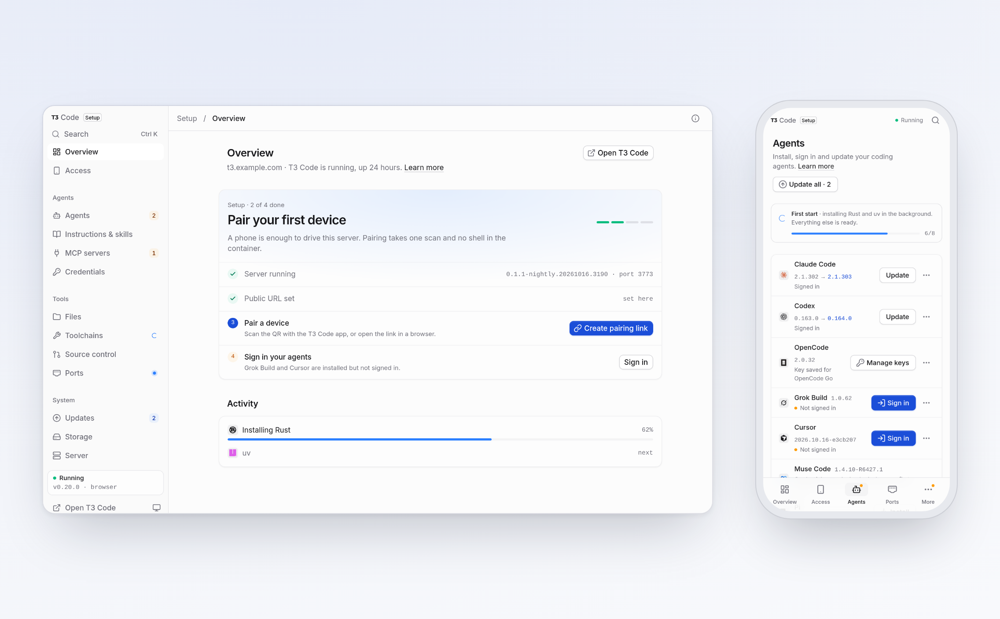

<div align="center">


<p>
  <a href="https://github.com/dizys/t3code-docker"></a>
  <a href="https://github.com/dizys/t3code-docker/actions/workflows/build.yml"></a>
  <a href="https://github.com/dizys/t3code-docker/pkgs/container/t3code-docker"></a>
  <a href="https://github.com/dizys/t3code-docker/releases"></a>
  
  <a href="LICENSE"></a>
</p>

<p><strong>Run <a href="https://github.com/pingdotgg/t3code">T3 Code</a> as a headless server in a container,<br>
with coding agents and language toolchains installed on first start.</strong></p>

<picture>
  <source media="(prefers-color-scheme: dark)" srcset="docs/media/setup-dark.png">
  
</picture>

</div>

T3 Code is a control surface for coding agents. The server runs the agents, git
and your terminals; the desktop, web and phone apps connect to it. This image
packages that server with the agent CLIs, language toolchains, a headless
browser, and a **setup page** for pairing devices, signing agents in and
keeping everything up to date, all without a shell in the container.

> [!NOTE]
> T3 Code is alpha software and changes quickly, and so does this image.

## Quick start

```bash
mkdir -p workspace
docker run -d --name t3code --restart unless-stopped \
  -p 127.0.0.1:3773:3773 -p 127.0.0.1:3774:3774 \
  -v t3-home:/home/t3 -v "$PWD/workspace:/workspace" \
  -e PUID="$(id -u)" -e PGID="$(id -g)" \
  --shm-size 1g \
  dizys/t3code-docker
```

1. **Get the setup key:** `docker logs t3code 2>&1 | grep -A1 T3_SETUP_KEY`
2. **Open <http://localhost:3774>** and enter it. **Overview** walks you through
   the rest: set a public URL, pair a device with a QR code, and sign agents in.
3. **In T3 Code**, turn the agents on under **Settings → Providers**.

On first start, the agents and toolchains install onto the `t3-home` volume in
the background. That takes a few minutes, and the setup page shows the
progress. Both ports listen on localhost only; see
[Reaching it from your phone](#reaching-it-from-your-phone) to go further.

### With Docker Compose

For a server you keep running, save this as `compose.yaml` and run
`docker compose up -d`:

```yaml
services:
  t3code:
    image: dizys/t3code-docker:latest
    container_name: t3code
    restart: unless-stopped
    ports:
      - "127.0.0.1:3773:3773"   # T3 Code
      - "127.0.0.1:3774:3774"   # setup page
    volumes:
      - t3-home:/home/t3        # state, sign-ins, agents and toolchains
      - ./workspace:/workspace  # your repositories, one project per git checkout
    environment:
      PUID: 1000                # `id -u` on the host
      PGID: 1000                # `id -g` on the host
    shm_size: 1gb
    logging:
      driver: json-file
      options: { max-size: "10m", max-file: "3" }

volumes:
  t3-home:
```

The setup key is in `docker compose logs t3code | grep -A1 T3_SETUP_KEY`.
Upgrade the image with `docker compose pull && docker compose up -d`.

Prefer to build from source, or want the optional Caddy HTTPS sidecar? Clone
the repository and use its [`compose.yaml`](compose.yaml) with
[`.env.example`](.env.example), which documents every option:

```bash
git clone https://github.com/dizys/t3code-docker && cd t3code-docker
cp .env.example .env      # set PUID/PGID and T3_WORKSPACE_HOST
docker compose up -d --build
```

## Images

| Tag | Image | Download |
| --- | --- | --- |
| `latest`, `browser` | Everything, including headless Chromium for the agents | ~1.0 GB |
| `core` | The same without the browser | ~0.7 GB |
| `X.Y.Z`, `X.Y`, `X.Y.Z-core`, `X.Y-core` | A pinned [release](https://github.com/dizys/t3code-docker/releases) | |

Published to Docker Hub as [`dizys/t3code-docker`](https://hub.docker.com/r/dizys/t3code-docker)
and to GHCR as `ghcr.io/dizys/t3code-docker`, each for `linux/amd64` and
`linux/arm64`. The old `full` and `slim` tags are retired; see
[Moving off `full` and `slim`](docs/configuration.md#moving-off-full-and-slim).

## Highlights

- **No shell needed.** [Manage files](docs/files.md), pair devices, sign agents in, and install or update
  everything from the setup page, which also opens from T3 Code's Settings.
- **Every T3 Code agent.** Claude Code, Codex and OpenCode install on first
  start; Grok, Cursor, Muse Code and Antigravity take one click.
- **Toolchains that survive upgrades.** Go, Rust, Bun, Deno and uv, plus about
  a thousand more tools through mise, live on the volume at exact versions.
- **A browser for the agents.** Headless Chromium with Playwright and Chrome
  DevTools MCP servers.
- **Publish a dev server.** Any port gets a public `https://` URL and a QR
  code, with no DNS or certificates.
- **Upgrade T3 Code in place.** Pick Stable or Nightly; a failed update rolls
  back on its own.
- **Pull requests on any host.** GitHub, GitLab, Forgejo, Gitea and Azure
  DevOps.

## What's in the box

| | `browser` (`latest`) | `core` |
| --- | :---: | :---: |
| T3 Code server and web app | ✅ | ✅ |
| git, gh, ssh, Node, Python, clang, ffmpeg, ImageMagick, psql | ✅ | ✅ |
| Claude Code, Codex, OpenCode | first start | first start |
| Grok, Cursor, Muse Code, Antigravity | one click | one click |
| Go, Rust, Bun, Deno, uv | first start | first start |
| glab, fj, tea, az (GitLab, Forgejo, Gitea, Azure DevOps) | one click | one click |
| mise, for per-project versions | ✅ | ✅ |
| cloudflared, for publishing a port | ✅ | ✅ |
| Headless Chromium and browser MCP servers | ✅ | — |

"First start" installs onto the `/home/t3` volume once, in the background;
"one click" installs from the setup page when you ask. `T3_PREINSTALL` changes
what the first start installs. Neither image contains credentials or model
access: you bring your own subscriptions or API keys.

## Reaching it from your phone

A phone needs an address it can reach. Pick one, then set it as the public URL
on the setup page so pairing links point there:

- **T3 Connect**, no domain needed: **Access → T3 Connect → Set up**.
- **One hostname behind a tunnel or proxy**: set `T3_SINGLE_PORT=8080` to serve
  T3 Code and the setup page together, and point Cloudflare Tunnel or your proxy
  at that port.
- **Your own domain with HTTPS**: the repository's Compose file has a Caddy
  sidecar, `docker compose --profile tls up -d`.
- **Tailscale or a trusted LAN**: use the machine's tailnet name or LAN address.

Ignore the pairing link in T3 Code's startup banner: it uses the container's
internal address and expires in five minutes. Use the setup page or `t3-pair`
instead. Details: [Reaching the server from a phone](docs/remote-access.md).

## Guides

| Guide | Covers |
| --- | --- |
| [The setup page](docs/setup-page.md) | The setup key, pairing, opening it from T3 Code |
| [Reaching the server from a phone](docs/remote-access.md) | Pairing, public URLs, tunnels, one hostname, link and session lifetimes |
| [Agents](docs/agents.md) | Installing, signing in and updating each agent |
| [Upgrading T3 Code](docs/t3code-updates.md) | Stable and Nightly, auto-update, rollback |
| [Toolchains](docs/toolchains.md) | Go, Rust and friends, any mise tool, per-project versions |
| [Source control](docs/source-control.md) | gh, glab, fj, tea and az sign-in |
| [Credentials](docs/credentials.md) | Saved SSH passwords and API keys, used by name without putting values in chat |
| [Publishing a port](docs/ports.md) | Public URLs for dev servers |
| [Giving agents a browser](docs/agent-browser.md) | T3's server browser and the browser MCP servers |
| [Context management](docs/context-management.md) | Global `AGENTS.md` and the shared skill library |
| [MCP servers](docs/mcp-servers.md) | Define once, compare and configure native agent copies |
| [Files](docs/files.md) | Browse, edit, upload, ZIP, Trash and project cleanup |
| [Storage management](docs/storage.md) | Disk usage, cache cleanup, version retention |
| [Configuration](docs/configuration.md) | Every environment variable, volumes, building |
| [Troubleshooting](docs/troubleshooting.md) | Pairing, providers, terminals, permissions |

Helper commands in the container, each safe to run with plain `docker exec`:

```bash
docker exec t3code t3-doctor          # what is installed, signed in and healthy
docker exec t3code t3-pair            # a pairing link and QR code
docker exec -it t3code t3-login codex # sign an agent in from a shell
docker exec t3code t3-harness list    # agents and their exact versions
docker exec t3code t3-expose 3000     # publish a port
```

## Security

An agent with a shell in this container can run anything, and the container is
the only boundary.

- **Pairing links and the setup key are credentials.** Serve over HTTPS and
  revoke what leaks, from the setup page or with `t3 auth pairing revoke <id>`
  and `t3 auth session revoke <id>`.
- **Don't publish port 3773, 3774 or `T3_SINGLE_PORT` unencrypted.** The
  examples above bind to localhost for that reason; use TLS or a tunnel.
- **A browser paired with T3 Code can open the setup page without the key**
  when both share a hostname, because T3 Code already gives it a terminal.
  `T3_SETUP_ACCEPT_T3_SESSIONS=0` turns this off.
- **Provider credentials live on the home volume.** Protect it as you would
  your own home directory.
- **`T3_ALLOW_SUDO=1` gives agents root in the container.** It's off by default.
- T3 Code's own [permission modes](https://github.com/pingdotgg/t3code/blob/main/docs/user/permission-modes.md)
  still apply. Start in supervised mode.

## Contributing

Issues and pull requests are welcome. See [CONTRIBUTING.md](CONTRIBUTING.md)
for the smoke test, the development console and how releases are made.

## License

MIT, see [LICENSE](LICENSE). T3 Code and the agent CLIs have their own
licenses; this repository packages them and does not relicense them.
