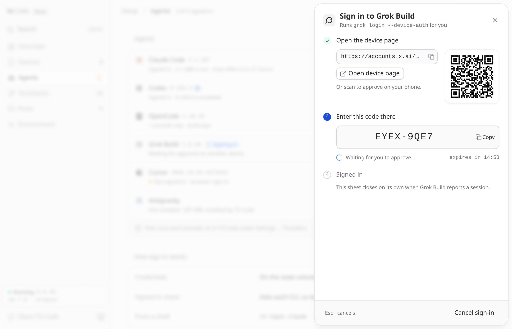

# Agents

Claude Code, Codex and OpenCode install on first start. Grok, Cursor and Muse install
when you press **Install** on the Agents page, or on first start with
`T3_PREINSTALL=all`. Each is installed into `/home/t3/.local/share/mise` at an
exact version, so it survives a recreate with the rest of the volume. Sign them
in from the setup page. `t3-login` does the same from a shell; it exists
because `docker exec` runs as root, and an agent signed in as root stores its
credentials where the server never looks.

| Agent | Provider in T3 Code | From a shell |
| --- | --- | --- |
| Claude Code | Claude | `t3-login claude` |
| Codex | Codex | `t3-login codex` |
| OpenCode | OpenCode | `t3-login opencode` |
| Cursor | Cursor (executable `cursor-agent`) | `t3-login cursor` |
| Grok Build | Grok Build | `t3-login grok` |
| Muse Code | Muse Code (Nightly) | `t3-login muse` |
| Antigravity | Antigravity (runtime installed by T3 Code) | — |

**Antigravity** isn't a CLI that mise installs. T3 Code runs Google's
Antigravity runtime, which it downloads itself (about 650 MB) into its own data
on the volume, pinned to the release it supports and checked against its
checksum. The Agents page uses T3 Code's own installer and sign-in:

- **Install** has T3 Code download the runtime, and turns Antigravity on in T3
  Code. The row shows the download's progress.
- **Update** appears when a T3 Code release supports a newer runtime.
- **Uninstall** has T3 Code remove the runtime. Your Google sign-in is kept.
- **Sign in** opens Google's sign-in. Afterwards your browser goes to an
  `http://127.0.0.1` address that doesn't load; paste that address into the
  sheet and T3 Code completes the sign-in.

The setup page talks to T3 Code using a session of its own, which isn't listed
under Devices.

**DeepSeek** has no T3 Code driver. Use it through OpenCode (see
[`examples/opencode/`](../examples/opencode/)), or point a provider instance's
environment variables at a compatible endpoint.

## Signing agents in and keeping them up to date

**Muse Code** is an optional agent: choose **Install** on its row in
**Setup → Agents**, then sign in with a Meta device code or save an API key.
It is excluded from the default first-start installs. Using Muse in T3 Code
requires **Nightly**, selected under **Setup → Updates**, and enabling
**Muse Code** under **Settings → Providers**. The image still starts with
Stable by default. You can also opt in with `T3_PREINSTALL=muse` or include it
in a comma-separated list; `all` and `agents` include it too.

Each row on the **Agents** page shows the agent's mark and the exact version
installed, and T3 Code is pointed at that executable. When a newer release is
available, the version gets an arrow and the row an **Update** button.
**Install a specific version…** and **Uninstall…** are in the row's menu. A
specific version is picked from the agent's list of releases, newest first,
each marked as newest, installed, on the volume, or how recently it came out.
Typing a prefix such as `2.1` picks the newest release under it.

**OpenCode's version picker includes both 1.x and 2.x.** OpenCode 1 remains
the default first-start install. Choose **Install a specific version…** on its
row and search for `2` to install OpenCode 2 from the official `@opencode/cli`
package through mise. It requires T3 Code **0.1.2** or newer, including **Stable**,
and OpenCode **2.0.18** or newer. The two distributions share one row and one
active `opencode` command; **Update** stays within the major version you selected.

Before switching majors, stop running OpenCode sessions and keep a backup of
its data. OpenCode 2 converts the shared OpenCode database on first use, and
installing the older CLI does not restore that database. The picker explains
this before starting a major-version switch. See the
[T3 Code OpenCode guide](https://github.com/pingdotgg/t3code/blob/main/docs/user/providers-opencode.md).

Downloads continue in the background. The row shows the progress and a
**Cancel** button, so a slow connection or a tunnel's request timeout doesn't
matter. Operations run one at a time: press Update on three rows, or **Update
all**, and they queue. If an update fails, the previous version stays
installed. By default nothing installs or updates on its own; the setup page
checks for new releases in the background every hour. **Setup → Updates**
gathers every agent, toolchain, added tool and source control CLI with a newer
release in one list, with **Update all** and **Check for updates** for a fresh
pass on demand. Under **Automatic updates** there, agents, toolchains and
tools (including source control CLIs), and T3 Code each have their own switch
and **Schedule**. By default each enabled category checks every 3 hours and
installs only after 30 minutes without activity (no open console or T3 Code
client, no install or update running).

If a source cannot be verified, the Updates page says how many, and
**Details** shows which, with technical details you can copy and a **Check
again** action. The last known releases stay visible. Long install errors have a short row
summary and a **Details** action for the full diagnostic.

T3 Code runs each agent through a small launcher the setup service writes in
`~/.local/share/t3-harness/launchers`. It runs the exact release installed here.
For providers with an in-app updater, T3 Code's own **Update** in
Settings → Providers goes through that launcher to `t3-harness update`, with
the same lock, version record and rollback as the setup page. Muse uses a
standalone managed binary; update it from **Setup → Agents**. T3 Code only
offers in-app Muse updates for its official auto-updating launcher. Run
the agent's own updater over a managed install instead, and this page and T3
Code would disagree about what is installed.

Pressing **Update** for an agent installs the newest stable release immediately,
both here and in T3 Code. It checks releases afresh and skips mise's 24-hour
release wait. First-start installs, toolchains and added tools still follow
`minimum_release_age`.

An update never selects an older version just because mise's release list is
behind. If you already installed a newer release, it keeps that version and
says so; if you are already current, it reports that without reinstalling.
To switch to an older agent release deliberately, use **Install a specific
version…** or `t3-harness update <id> --version <exact-version>`.

From a shell:

```bash
docker compose exec t3code t3-harness list
docker compose exec t3code t3-harness update codex
docker compose exec t3code t3-harness install claude --version 2.1.285
docker compose exec t3code t3-harness uninstall grok
```

Uninstalling removes the executable and T3 Code's path to it, and keeps
credentials and user data, so reinstalling brings you back signed in. An agent
you uninstall stays uninstalled for the life of the home volume: the first-start
install won't bring it back. If you set an agent's binary path yourself in T3
Code's provider settings, the setup page leaves it alone.

Each agent offers the sign-in methods it supports:

| Agent | Sign in | API key |
| --- | --- | --- |
| Claude Code | `auth login`: shows a URL, then takes the code back | — |
| Codex | device code (`login --device-auth`) | stored with `login --with-api-key` |
| OpenCode | use `t3-login opencode` for the CLI's other methods | choose a provider; saved through the active major version's native store |
| Cursor | browser sign-in, checked until it completes | — |
| Grok Build | device code: a URL and a code to confirm | — |
| Muse Code | Meta device code: a URL and a code to confirm | stored with `auth set --api-key-stdin` |
| Antigravity | Google sign-in through T3 Code: paste back the address you land on | — |

**Sign in** opens a sheet that follows the agent's own flow as numbered steps:
open the sign-in page (or scan its QR code with your phone), enter the device
code, or paste the code the browser gives you. The sheet closes once the agent
reports that it's signed in, and **Esc** cancels and stops the CLI. The setup
page runs the CLI and reads its output; you never type into a terminal.

<p align="center">
  
</p>

Sign-in status uses each CLI's native status interface where available. The
exceptions below report saved credentials without testing a remote request.
For Claude Code, `ANTHROPIC_API_KEY` and `CLAUDE_CODE_OAUTH_TOKEN` in the container environment
both count, as they do for T3 Code:

| Agent | Checked with |
| --- | --- |
| Claude Code | `claude auth status --json` |
| Codex | `codex login status` |
| Cursor | `cursor-agent status --format json` |
| Grok Build | `grok models`, plus `XAI_API_KEY`, as T3 Code does |
| OpenCode | 1.x: its `auth.json`; 2.x: `auth list --format json --standalone` for saved accounts |
| Muse Code | saved credentials in `~/.config/muse/auth.json`; sign-in is checked on the first message |
| Antigravity | T3 Code's provider status |

Codex 0.164.0 changed API-key status from "Logged in using an API key" to
"API key configured". Setup recognizes both formats so a saved key updates
the Agents row and completes an active sign-in.
A configured key confirms local storage; Codex checks whether the key works
when you send a request.

Muse has no login-status command, and its model list works while signed out.
The setup page reports saved credentials without claiming that they are
verified. It ignores an inherited `META_API_KEY`, as T3 Code does; save the
key here or set it on the Muse instance in **Settings → Providers**.

Grok has no status command, and its credentials file can't be trusted on its
own: a file in exactly the documented format still leaves the CLI reporting
"You are not authenticated". So the setup page asks the CLI, which takes about
a quarter of a second. When the status can't be determined, the row says
"Sign-in state not readable".

OpenCode takes a key per provider, and there are more than two hundred, so the
setup page offers the [models.dev](https://models.dev) catalog as a picker,
with **Other — type an id** for anything not listed. The catalog is fetched
once and cached on the state volume, so it keeps working after restarts and
offline.

OpenCode 1 saves keys in `$XDG_DATA_HOME/opencode/auth.json` (by default
`~/.local/share/opencode/auth.json`). OpenCode 2 migrates that file once into
its database (see the [OpenCode provider guide](https://dev.opencode.ai/v2/docs/cli/providers/)).
Setup, sign-in checks and `t3-doctor` use the managed release's
store, so an old `auth.json` cannot make a V2 installation appear signed in.
The whole OpenCode data directory, including database sidecars, persists on
the home volume. An unreadable store or unknown version is reported without
replacing the file or falling back to the other major version's store.

In OpenCode 2, **Save key** uses its native key connection API to add and select
a new account, keeping existing accounts. Custom providers must already be
configured in OpenCode and support a key connection. **Saved sign-ins** shows
an account count per provider; **Remove** confirms that it removes every saved
account for that provider, including browser sign-ins. Other providers and
environment credentials are kept. The list refreshes in the background while
the provider picker remains usable, and refreshes preserve your draft key.
These checks confirm local storage, not that the provider will accept the key.

From a terminal with a TTY, OpenCode 2 also accepts an integration and method:

```bash
docker compose exec -it t3code t3-login opencode anthropic --method key
```

OpenCode 1 uses its interactive picker instead. If the managed version cannot
be checked, extra login arguments are rejected rather than guessed.

You can also use T3 Code's own provider setup, which opens a terminal on the
server with the sign-in command ready to run. Both store credentials in the
same place. Revoking a device's session signs that device out; it doesn't
affect your threads, projects or provider sign-ins.
