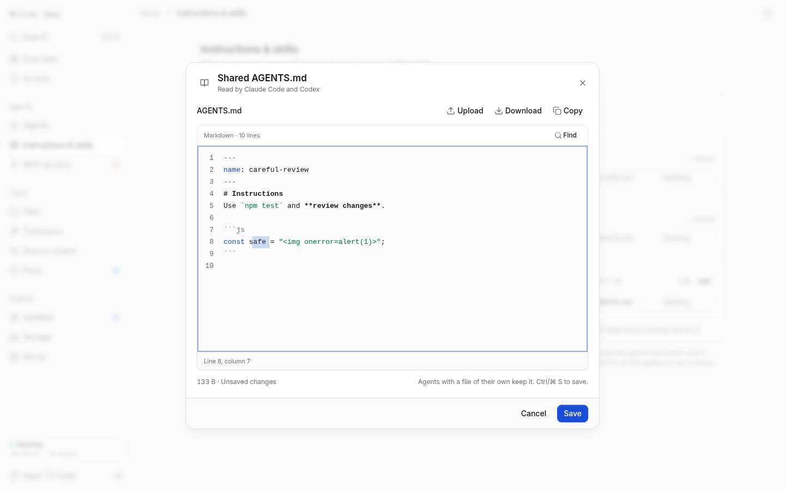

# Global agent instructions

**Setup → Instructions & skills** edits the shared AGENTS.md and each agent's
own instruction file, on its **Instructions** tab; skills are on its **Skills**
tab (`#instructions/skills`). Shared servers live on the separate
[MCP servers](mcp-servers.md) page (`#mcp`). A two-column overview shows a safe text preview of
AGENTS.md beside the per-agent source choices. The instruction editor is centered
on desktop and opens as a bottom sheet on phones. Uploading a Markdown file
replaces the draft; only **Save** applies it. Downloads include unsaved edits.
The editor shares Files’ bounded syntax renderer: Markdown headings, frontmatter,
inline code and fenced source get syntax accents with line numbers. **Find** or
**Ctrl/Command F** searches the complete draft. Escape closes Find before asking
to close the editor. Native selection, copy, undo and input methods remain
available. The Skills inspector uses the same surface for reading and editing
SKILL.md, including read-only installations.
Closing or leaving with unsaved edits asks before discarding them. Browser reloads
warn while edits or a save are pending, and navigation waits for a save to finish.

<picture>
  <source media="(prefers-color-scheme: dark)" srcset="media/source-editing/instructions-dark.png">
  
</picture>

The canonical file lives at `$T3CODE_HOME/setup/context/AGENTS.md`, on the state
volume. Saving writes it atomically with mode `0600`; initial creation links
missing native files:

| Provider | Native global instruction target | Environment override |
| --- | --- | --- |
| Claude Code | `~/.claude/CLAUDE.md` | `CLAUDE_CONFIG_DIR` |
| Codex | `~/.codex/AGENTS.md` | `CODEX_HOME` |
| OpenCode | `~/.config/opencode/AGENTS.md` | `XDG_CONFIG_HOME` (config root) |

The shared file's header says which agents read it. Its actions menu offers
upload, download and delete; the preview refreshes when its revision changes or
when you retry a failed preview. A long preview shows its first 18 lines in a
scrollable region; the editor opens the full file. Under **What each agent
reads**, each agent has one choice of three:

- **Shared AGENTS.md** uses the global file, so subsequent global edits reach
  that agent. **Edit** opens the shared editor. Switching an existing own file to it
  asks for confirmation and backs up its directory entry next to the native file,
  with the suffix `.t3-context-backup`. Existing backups are never overwritten.
- **Its own** `CLAUDE.md` or `AGENTS.md` uses the agent's own file, with its path
  under the agent's name. Switching back restores its previous
  file, including the original permissions or relative symlink. If there is no
  previous file, it starts with a copy of the shared instructions; before shared
  instructions exist, it starts with a Markdown heading. Its editor opens after
  switching. Later shared edits leave its own file alone.
- **Nothing** removes the native link or parks its own file in its backup slot,
  after asking. Later global edits leave it disconnected; choosing its own file
  again restores the backup.
  Deleting the global file disconnects shared providers and keeps backups.
  Creating the global file again bootstraps missing native links.

Source choices are inferred from the native files and links; there is no new
manifest format. Provider IDs select fixed paths, so callers cannot supply an
arbitrary file path. A stale source selection is refused. A failed switch rolls
back the original entry when possible, and a preserved backup can be restored
by choosing the agent's own file after an interrupted switch. A cancelled or
failed change leaves the choice showing what is in effect.

Provider edits load the file's current contents and follow symlinks to the real
file, preserving the chain and file permissions. Other agents using the same
external file see that edit too. Shared and provider editors reject stale saves;
provider editors also detect a retargeted link. On a conflict, download the draft
and reopen the editor to load the current file. Missing or unreadable targets
cannot be saved over.

Status polls and editor loads check the resolved file size before reading.
Files larger than 64 KiB stay in place and show as too large to edit; reduce
them directly on disk before editing in the console. Reads are capped at
64 KiB plus one byte to detect growth after the size check. Shared and separate
source choices remain visible, but unavailable files cannot be edited or
switched through the console.

Creating shared instructions links missing native files; later saves update only
providers already using Shared. Existing separate
files stay in place until the user explicitly chooses Shared for that provider.
A symlink at the canonical shared file is refused rather than replaced.

Start a new agent session after saving: an existing session may retain the
instructions it loaded at startup. Project instructions and provider-specific
precedence still apply.

Only these three native instruction integrations are included. Project
instruction editing, saved setups and Cursor rule translation are outside this page.
Skills and source imports are described below.

## Global skill inventory

The **Skills** tab is one library across installed Claude Code, Codex,
OpenCode, Cursor, Grok Build, Muse Code and Antigravity agents. Each physical
`SKILL.md` is one row, joined by resolved path, with one column per installed
agent. A name appearing in two different folders remains two installations.
The **Installed agents** menu in the Skill header switches to **All agents**,
including agents that are not installed. Skill names, row actions and folder
context stay visible while scrolling across agent columns. On phones, the
matrix becomes a grouped list with available-agent chips and a fixed install bar.

**Table** and **Cards** beside **View** switch the library layout on wider
screens, and the choice is remembered in this browser. Cards keep the same
folder groups. Each card shows a skill's name, description, the agents that can
use it and any agent that limits it, such as **Ask in OpenCode**. Open a card
for everything else. Phones always show the grouped list.

Groups identify the owning folder, its actual path, and the other agents that
read it. System/admin groups start collapsed. Search matches names and
descriptions; **Available to** and **Needs attention** filters combine with it.
Metadata problems explain what may prevent a skill loading and link to its editor.
Each agent's policy belongs to that column: saving disables that column's other
controls while other agents stay usable. A failed write explains the error and
refreshes only that agent.

A skill name opens a 520px side inspector, or a bottom sheet on a phone. It shows
per-agent availability, actual and linked locations, bounded file metadata,
and a read-only text view with line numbers. **Found** means the file is in a
folder the agent reads; that agent does not report which skills it loads.
It does not assert that a live session has loaded the skill. Native state that
cannot be changed shows a lock and its reason.

The file list reports names, sizes and executable bits without reading supporting
file bodies or following their links. It is limited to 1,024 entries and 12 levels;
nested installations or unreadable trees show a reason instead of an incomplete
list. Linked installations describe the approved target while removal still only
unlinks the installation. Read-only package, compatibility and system skills can
be inspected without gaining edit/removal authority. Copy and download preserve
Markdown as text; it is never rendered as HTML or executed.

Metadata uses a pinned vendored YAML parser, including quoted names and folded
descriptions. Parse problems, name/folder mismatches, missing targets and oversized
files stay visible. Content reads are limited to 64 KiB, frontmatter to 16 KiB.
Local scans are bounded by entries, depth, skill count, bytes and elapsed time.
Truncated or unavailable locations produce visible scan messages.

The managed Codex executable is queried through its App Server using only
`initialize` and `skills/list` for inventory; no conversation or model turn is started.
Native global/system/admin entries include Enabled/Disabled state. Known local
files absent from that native result remain Unverified. Native discovery has a
six-second deadline and a 2 MiB output limit; unsupported or unavailable versions
fall back to the local list with a reason. Custom T3 provider binaries,
environments and project/session overrides may produce different inventories.

Claude and OpenCode supplement known-folder discovery with native user policies
and runtime metadata, as described below. Cursor, Grok, Muse and Antigravity show
**Found** with a discovery-only explanation. Plugin inventories and configured extra locations
are outside the basic known-folder inventory.

**View → Show bundled skills** controls entries identified as system skills,
such as those shipped with Codex. They start shown in a collapsed group. Hiding
only filters this list; agents can still use them. A quiet row lists the hidden
skills and offers **Show**. User, administrator and plugin installations stay
visible unless the provider identifies them as system skills.

The same **View** menu chooses **Installed agents** or **All agents**. Both
choices are remembered in this browser. On phones, the View icon is beside
search and controls the agent chips.

Inventories load in parallel when the Skills tab opens. **Rescan** refreshes all
installed agents after external changes. One failed provider leaves the others usable. Concurrent requests share a lookup and results
are cached for 15 seconds; regular `/status` polling does not scan skills.
Each inventory also reports its provider adapter: the global skill folder,
the project skill folder where one is verified (Codex, Cursor, OpenCode and
Antigravity share `.agents/skills` inside a project), and whether the tool
itself is detected. Detection never gates management: an undetected column
says **Not detected**, and adding, editing and importing still work. Use the
`+N` header button or **View → All agents** to include these folders. The installer
only uses an undetected agent’s folder after you explicitly select that agent.
Bodies load separately through authenticated, discovered-installation IDs.
`GET /context/skills/read` adds `files: [{ name, bytes, executable, linked }]`
and `fileCount` (or `filesError` if inspection is bounded/unavailable); the numeric
`removalFiles` field and opaque removal revision keep their existing meanings.
Details refuse a link retargeted after discovery. No skill files, provider
settings or persistence mappings change during inventory reads. Native Codex
startup may maintain its own system-skill cache as usual.

### Add, edit and remove local skills

All seven providers' own user skill folders support **New skill**,
**Edit** and **Remove**. Add accepts a portable folder name and raw Markdown,
including upload/paste. The frontmatter name must match the new folder name.
Existing installation names are never overwritten; new files use mode `0600`.
Codex and OpenCode also offer a **Shared .agents folder** location when adding
skills. Unmanaged shared installations can be edited or removed; those changes
affect every provider using the same files. Claude does not discover this shared
root automatically, so its Add dialog offers only its provider folder.
These native directories already participate in the image's agent-home
persistence when `T3_PERSIST_AGENT_CREDENTIALS` is enabled. Custom locations need
their own persistent mounts.

Editing changes only `SKILL.md`, preserves its existing permissions and follows
user file/directory symlinks. Supporting scripts and references stay in place.
Providers using that same target see the change too. Read responses include a
revision covering content, target identity and permissions; saves reject stale
revisions, missing targets and retargeted links. A failed save retains the draft
for download. Save uses a temporary file and atomic rename, with serialization
per resolved target. An external writer can still race between the final check
and rename; this is not a filesystem transaction with other applications.
Closing, changing pages or copying to another agent asks before discarding a
skill draft. Saving keeps the editor open until its result arrives.

Removal requires confirmation and both a file revision and a bounded supporting
tree fingerprint. A changed supporting file invalidates the confirmation.
Ordinary skill folders are moved aside, verified again and removed, including
their supporting files. Directory/file link removal preserves the linked target.
Root-level Markdown removal removes only that file. A skill containing a nested
installation cannot be recursively removed from the console. Changes during the
move trigger rollback; if the original path is occupied, or removal fails, the
error identifies the preserved entry for manual recovery.

System, plugin, package-tracked and compatibility installations remain read-only
here; a provider's own root linked to unmanaged shared storage remains editable.
A root linked to system/plugin storage cannot create skills. The global skills CLI lock is read only to recognize
package ownership; the console does not edit its lock or create a T3 manifest.
Oversized/unreadable locks conservatively disable local changes. When credential
persistence is enabled, `.agents/skills`, `.local/state/skills` and the optional
`.agents/.skill-lock.json` are anchored on the state volume. The rest of `.agents`
stays in place. An absent lock is linked without inventing a JSON document; the
upstream CLI owns its contents. Existing mounts and symlinks are respected.
Custom XDG state paths need their own persistent mount. These ownership restrictions
cover Markdown changes; provider policies can still apply to package-owned skills.

### Install skills from sources

**Install from source** opens a desktop dialog or phone sheet. Enter a source,
review its skills and supporting files, choose agents and destination folders, then review
the exact destination folders before installing. A single discovered skill is
selected automatically; collections require a selection. Existing folders are
never implicitly overwritten. Replacement requires an explicit checkbox and
rechecks the original skill and its supporting tree immediately before writing.

Repository discovery prefers published `skills/`, agent skill containers and
immediate skill folders before falling back to other bounded layouts. A tool
repository’s private workflow skills are not mixed into its published library;
an explicit folder/name source can still select them.

Supported inputs include:

- GitHub `owner/repo`, `owner/repo@skill-name`, repository URLs, and
  `/tree/branch-or-tag/skill-folder` links. A full commit SHA can replace the ref.
  Copied tree links resolve slash-containing branches/tags against advertised
  Git refs; incomplete tree links are refused.
- GitLab repositories, `/-/tree/ref/folder` links and `/-/blob/ref/file` or
  `/-/raw/ref/file` Markdown links; other Git hosts through
  HTTPS URLs ending in `.git`, `git@host:owner/repo.git`, or `ssh://` URLs.
- `skills.sh/owner/repo/skill-name` links and copied `npx skills add`,
  `pnpm dlx skills add`, or `bunx skills add` commands with one `--skill` selector.
  `--skill '*'` previews the collection. Commands are parsed as text; no shell command is executed. Choose providers
  in the dialog instead of supplying command flags.
- Direct HTTP(S) `SKILL.md` URLs, including GitHub file links. Only that Markdown
  file is imported; use a repository/folder to include scripts and references.
- An absolute folder/file path, or `~/...`, **inside the container**. Markdown
  upload/paste remains available in **New skill** for files on your phone/computer.
- HTML catalog pages with GitHub, GitLab or skills.sh links. AgenticSkills'
  `/skills` listing also exposes its skill-detail links. Search those links,
  choose a detail page, then choose its repository/folder link. HTML and site
  scripts are never rendered or executed. This is link discovery from the
  supplied page, not a maintained or endorsed catalog.

The three steps keep one reviewed snapshot throughout:

1. **Skills:** read a source, filter/select skills, inspect its files and safe text,
   and see installed/update badges. Git previews identify their resolved commit.
2. **Agents:** choose **Fewest copies** or **A copy per agent**, review destination
   groups, side effects and blocked paths, and explicitly consent to replacements.
   Changing any choice clears the old plan and consent immediately. Late plan
   responses cannot enable installation of a different selection.
3. **Install:** inspect per-copy results, including warnings and partial failures.
   **Review again** reviews a failed destination using the same snapshot, without
   repeating successful writes. **Show in library** highlights the installed names.

**Fewest copies** checks all subsets of at most seven writable, installed agents'
own folders. It minimizes physical folders, then agents reading duplicate copies,
then prefers agents' own folders. With Claude, Codex, OpenCode, Cursor and Grok
selected, it uses Claude's and Codex's folders; Cursor can find both identical
copies. The rail states that side effect and any unselected agents whose
compatibility paths can also find the copies. These are discovery facts, not a
promise about precedence or how many copies an agent loads into a session.
[Cursor's documentation](https://prod.cursor.com/help/customization/skills)
confirms the compatibility folders but does not specify duplicate-name resolution;
the planner retains the handoff's ordering rather than guessing runtime behavior.
New skills use each agent's defaults; the result does not claim Codex enabled them.

The reach map comes from authenticated `GET /context/skills/reach`. It uses the
same seven-provider roots and environment overrides as discovery, joins aliases
by resolved path, and reports readers and writable owning providers. It grants
no write authority: the plan/install APIs still validate every destination.
Closing discards the snapshot; a late response is discarded too. Snapshots expire
after ten minutes and require reading/reviewing the source again. Closing is
blocked only during publication. `Ctrl/⌘+Enter` advances the current step.
Publication also freezes the reviewed choices. If the connection drops or the
service returns a server error, **Retry installation** repeats the same reviewed
request to retrieve its recorded result. It does not create a new plan or repeat
successful writes. Choices stay fixed until the outcome is known; closing the
wizard remains available once the request has finished. A server restart or an
expired snapshot requires reading the source again.

Imports create independent local copies in these native global locations:

| Provider | Default destination | Override |
| --- | --- | --- |
| Claude Code | `~/.claude/skills` | `CLAUDE_CONFIG_DIR` |
| Codex | `~/.codex/skills` | `CODEX_HOME` |
| OpenCode | `~/.config/opencode/skills` | `OPENCODE_CONFIG_DIR`, `XDG_CONFIG_HOME` |
| Cursor | `~/.cursor/skills` | — |
| Grok Build | `~/.grok/skills` | `GROK_HOME` |
| Muse Code | `~/.config/muse/skills` | `XDG_CONFIG_HOME` |
| Antigravity | `~/.gemini/config/skills` | — |

The Antigravity inventory also includes `~/.gemini/antigravity-cli/skills`;
T3 links both native roots into its private provider profile. Its CLI folder
remains a separate, read-only source in the console. Grok inventory includes
Cursor compatibility skills as well as its Claude/shared roots. See
[T3’s native Antigravity skill paths](https://github.com/pingdotgg/t3code/blob/main/apps/server/src/provider/Drivers/AntigravitySkills.ts).

Provider folders can already be symlinked onto shared storage. Review resolves
these paths, combines destinations pointing at the same physical folder, and
refuses retargeted roots. Compatibility discovery can expose a selected provider's
skills to other providers too. Imports leave provider settings alone: existing
visibility/permission/enablement rules still apply. Availability is verified for
Claude/Codex/OpenCode through the existing inventory integrations; the other
providers retain **Found** with a discovery-only explanation. Start a new conversation to load
changes. Custom provider environments and older runtime versions may differ.
Native path references: [Cursor skills](https://cursor.com/docs/skills),
[Grok skill locations](https://github.com/xai-org/grok-build/blob/main/crates/codegen/xai-grok-pager/docs/user-guide/08-skills.md),
[Muse skills](https://meta-models.github.io/muse-code-sdk/next/guides/extend/skills/),
and [Antigravity skills](https://antigravity.google/docs/skills).

When a repository publishes the same skill name in `skills/` and an agent-specific
folder such as `.openclaw/skills/`, preview prefers the published copy and warns
which variant was skipped. Name selectors use the same precedence. Paste a
specific folder link to choose another variant. Duplicate names within the same
discovery priority still require a specific folder.

Repository installs remember their source and a fingerprint of the installed
files in `.t3-skill-source.json` inside the skill folder. Local **Copy to…**
copies omit this metadata, preserve local edits and executable files, and need a
repository re-import or a link to enable their own update tracking.

To track a skill you already have, open it and use **Link source** with a
repository, a skill link or `owner/repo`. The source must contain a skill with
the same name; a source with one differently named skill asks first. Linking
records a fingerprint of the files you have now, so if they differ from the
source, the next check reports an update. **Unlink source** keeps the files and
stops checks. **Check for updates**
on the Skills tab checks tracked repository installs on demand, fetching each
source once per check action. A later check fetches fresh contents. It compares the
skill's complete source contents and executable flags, so unrelated repository
commits do not trigger an update. Ordinary inventory refreshes never fetch sources.
The library’s **Updates** view lists every tracked installation, including
failed and not-yet-checked sources. It sorts available updates first, then failed
checks, unchecked skills and current skills. Search and **Available to** still
apply. On phones, the **Updates** chip holds repository check controls; an
active check also stays visible in the library. Failed rows show the error and a **Retry** action for that installation.
Successful checks retain the branch, commit and check time until the Setup
service restarts; source tracking survives restarts. **Check again** always
fetches fresh repository contents. Current skills have no badge in the library.

Choose **Review update…** from a row, its menu or its inspector. **Review N
updates** works through available rows in order, with a skip action and the next
review after each result. Closing ends the queue. Each review shows its exact
folder and detected readers, file counts, and a file list. Select a file to read
its inline diff, incoming contents or installed contents; unchanged context can
expand in place. Phones use one open file accordion at a time.

Text previews are UTF-8 only, at most 64 KiB per file and 1 MiB per review.
Binary, linked, oversized and omitted files say why no text is shown. Above
5,000 lines the full incoming and installed views remain available without a
line diff. These preview limits do not change what is installed.

When the folder has local edits, **Save current SKILL.md** downloads its current
instructions and **Replace my local edits** must be checked before updating.
Without local edits, the primary action is ready after review. It names the
detected agents affected by that folder. Updating replaces the complete folder
in place, including local edits and removed/renamed supporting files. Known
compatibility readers share the change; no extra copies are created. Availability
settings stay the same, and agents use the files in new sessions.

Checking alone never changes installed files, and local edits do not count as
upstream updates. A ref pinned to a commit keeps checking that commit. Earlier
installs and imports from local folders or direct Markdown links need a
repository re-import or a link to enable tracking. **Copy to…** remains a
separate operation.

Updates install by themselves only when you ask twice: turn on **Skills** under
**Updates → Automatic updates**, and tick **Auto-update this skill** in the
skill's inspector. Both start off. The Skills switch then checks the opted-in
skills on its own schedule and, once the server has been idle long enough,
installs the updates that check found. It skips a skill with local edits, and a
skill whose files already differed from its source when you linked it, until
you review an update by hand; those stay in **Updates** with **Review
update…**. An update keeps the skill's auto-update setting. Manual checks and
reviews work whether or not the switch is on.

Tracked skills in the shared `.agents/skills` folder update there. Links into
managed global skill folders keep their links and update the reviewed target;
links into unrelated or protected locations cannot authorize replacing a folder.
The server resolves destinations from discovered installation IDs and rechecks
the folder, supporting files, tracking metadata and known readers before
publication. Edits or retargeted links require a new review and fresh consent.
File comparisons are bounded by the import limits and never follow supporting
file links. Large local files are conservatively treated as local changes.
Lost responses retry the same reviewed operation; a fresh review never silently
replays an uncertain update.


Use **View → Remove** to delete an imported local skill. Files tracked
in the upstream skills CLI lock remain read-only here, including during import;
manage those packages with their package manager. Unreadable locks, known plugin/system
roots (including Grok/Antigravity plugin folders and Codex admin skills), linked
individual skill folders/files, unrelated existing folders and nested
installations cannot be replaced by a new import. The tracked update flow can
preserve links whose reviewed target is inside a managed global skill folder.

This follows the state-format boundary discussed in PRs #25 and #31. The
[upstream skills CLI](https://github.com/vercel-labs/skills) remains an alternative
for package installation and tracking; the console continues to recognize its
lock and shared files. Calling it directly for this flow would permit replacement
of user folders and use a different set of provider paths/overrides. Source
imports therefore extend the existing local-file model without introducing a
T3 lock format, rewriting the CLI lock, or adding runtime npm dependencies.
Archive downloads, well-known indexes and full package update automation are
not supported by this local import flow.

Preview is read-only. Git uses shallow clones without checkout, submodules,
hooks or filters; the resolver reads blobs directly, never runs installation
scripts and skips linked/special entries with visible warnings. Git uses the
container's configured credentials without prompting. HTTP requests do not
attach Git credentials. Embedded URL credentials and unsafe protocols are
rejected. Private sources can use configured Git/SSH credentials.

Preview limits are 45 seconds for Git/HTTP, 64 MiB monitored Git storage, 2 MiB
Git listing output, 1 MiB HTTP page download, 2,048 source files, 128 skills,
64 KiB Markdown, 4 MiB per supporting file, 25 MiB total retained contents,
12 levels within a skill and 1,024 entries per installed tree. Narrow large
repositories to a skill folder to reduce discovery/retained content. The clone
storage limit still covers the repository, not just the selected folder. Git LFS
objects and submodules are not downloaded. Git storage is checked during cloning and
before/after commands; a fast download can temporarily exceed the monitored
threshold. Oversized Markdown candidates are skipped with visible warnings so
that a valid sibling can still be listed or selected; an oversized-only selection
is refused without opening the large file. The complete Git/SSH process group is
killed on timeout/limit failure.
No preview or clone enters `/status` polling. Source snapshots expire after ten
minutes (at most three per setup process); expired entries are pruned on the next
import operation. Closing a source or destination read releases its snapshot when
the read finishes; it cannot overwrite a newer dialog or its draft. Reads can
finish in the background for up to the source timeout. Closing is disabled only
during installation. Snapshots are lost on server restart. Catalog link lists
are capped at 256 entries.

Installation uses only that immutable preview, never re-fetches the source, and
accepts opaque preview/plan IDs instead of caller-supplied destination paths.
Writes stage a complete folder beside the destination. A replacement parks and
rechecks the previous tree before publishing; failure restores it when the
original path is available, otherwise the error identifies the preserved backup.
Separate provider writes can partially succeed; results identify each success or
failure. Retrying the same completed plan returns its recorded result. After a
partial failure, explicitly reviewing again creates a new plan/revision against
the original immutable snapshot and invalidates the old plan ID. A successful
completed plan cannot be reviewed/replayed as another installation. A process
crash can leave hidden `.t3-skill-import-*` staging or `.t3-skill-backup-*` recovery
folders, which discovery ignores. External processes can still race the final
filesystem checks; this is not a cross-application transaction.

All native default locations, including both scoped Antigravity skills directories,
participate in agent persistence when `T3_PERSIST_AGENT_CREDENTIALS` is enabled.
Custom paths require their own mounts. The rest of `.gemini` is left in place.

### Native Codex availability

A switch in the row turns on or off user skills verified by the managed Codex
inventory, including shared and package-tracked user skills. The console sends
the selected installation's path to Codex's native `skills/config/write` method.
It changes Codex availability only, leaves Markdown and other providers alone,
and uses Codex's existing user configuration persistence. System, admin, plugin,
unavailable and filesystem-only entries do not offer these controls.

Requests carry an opaque revision covering native settings and the selected
installation/state. The service reloads inventory and checks settings immediately
before writing, rejects stale requests, and serializes console changes against
the same config file. Settings reads are bounded to 1 MiB; unsafe or unavailable
settings leave inventory usable with controls disabled. Configuration contents
are never included in responses. Codex preserves the configuration through its
own writer; the console does not parse or rewrite TOML.

Both the write acknowledgement and a freshly started native inventory must
confirm the requested state before success is reported. Failed or ambiguous
writes trigger a refresh; they are not automatically rolled back. Native writes
do not support compare-and-swap, so an external writer can still race the last
check. Start a new conversation after changing availability: loaded instructions
can remain in existing conversations, and project/session settings may differ.

### Codex plugin hook review

In Skills, **Codex plugin hooks…** opens installed plugins’ automatic commands,
including plugins without skills. A notice and plugin-folder chip appear when
commands are waiting for review. A skill’s inspector can open the sheet filtered
to its plugin; **All plugins** returns to the full list.

Each hook shows a readable event label, complete command, source path, matcher,
time limit and the access it runs with. **Trust command** (or **Trust new
command**) records consent to the exact definition displayed above it. It does
not turn on an off hook. Trusted hooks have an On/Off switch; managed hooks and
unsupported types are read-only. Trust buttons never receive default focus, and
there is no second confirmation repeating the command.

Trust and On/Off changes show pending feedback and use the complete native
response for the next action’s revision. If the command or settings changed,
the card reloads and stays expanded with the new command to review. A failed
read cannot leave stale actions enabled. Start a new Codex session after changing
settings. Hooks run with your container user’s access and apply to the plugin,
including all its skills. Importing skill folders adds instructions; it does not
install a plugin or its lifecycle hooks.

The library reads hooks once when first opened with Codex installed. The sheet
shares that result; **Refresh**, **Rescan**, completed changes and closing the
sheet refresh the inventory. Routine status polls never invoke hook discovery.
A library discovery failure stays quiet; opening the sheet shows the error and
recovery action.


The console uses Codex's experimental `hooks/list` and native config APIs. It
never starts a thread, executes a hook or bypasses hook trust. Changes check the
reviewed definition and settings revision, use Codex's config version check,
then verify the result. Changed definitions require another review. Managed
hooks and hook types whose complete action is unavailable through native
metadata stay read-only. Discovery errors and unsupported Codex versions show
an error with a refresh action; no trust is inferred from skill availability.
Only global installed-plugin hooks in the setup environment are managed here;
project, user-defined and session-specific hooks remain in Codex's `/hooks` UI.

### Claude visibility and OpenCode permissions

Claude's **Visibility** menu, in each skill's row, preserves all four native `skillOverrides` states:
On, Name only, Manual only and Off. These mean name + description, name only,
manual invocation only, and hidden from both Claude and the slash menu. The
[official visibility reference](https://code.claude.com/docs/en/skills#override-skill-visibility-from-settings)
documents those states; the metadata-only native smoke test checks them against
Claude Code 2.1.305 without a model turn. The console edits only the selected name in
the resolved user `settings.json`, requires strict JSON, and preserves unrelated
settings, file mode and symlinks. Claude silently ignores commented settings
files, so JSONC is rejected here. Controls require the tested 2.1 interface
(2.1.260 or newer); unsupported releases retain the known-folder inventory.

A bounded stream-JSON initialization reads Claude's command metadata without a
user message or model turn. Project settings are excluded, MCP servers are
disabled for the check, and hooks are disabled through a settings overlay.
The UI distinguishes the saved **user policy** from whether the manual command
is actually listed; frontmatter and managed settings can still restrict use.
Duplicate names share the same native override. Plugin policies stay with the
plugin manager.

OpenCode's **Permission** menu, in the same place, offers Allowed, Ask before use and Denied. V1 uses
`permission.skill` by skill name; V2 uses ordered `permissions` rules and native
path-derived skill IDs. The editor preserves JSONC comments, unrelated policies
and wildcard rules, and changes an exact rule or appends one after existing
matches. When both global JSON and JSONC files exist, it edits JSONC, which loads
last. `OPENCODE_CONFIG_DIR` and XDG config overrides are honored.

V1 verification uses bounded, sequential native debug reads with external plugins
disabled. These processes share provider state; concurrent first use can race
database initialization in a fresh home. First use can also create a higher-priority
`opencode.jsonc`. Discovery reselects and reloads the configuration once before
returning policy state/revisions, so the first policy change does not use the
previously absent JSON source. Repeated source changes disable controls until
the settings stabilize.
V2 starts a private loopback metadata server and waits for skill/agent plugins to
activate before reading inventory. The early empty result from a one-shot API
request is not authoritative. Only the installation selected by native inventory
gets a policy control. The UI reports the Build agent's resolved permission
separately, preserving agent-specific restrictions rather than overriding them.
Other agents, managed policies and session rules can differ.

Both editors check revisions, serialize writes to the same settings file,
preserve modes/symlinks and verify through a fresh native process. Invalid syntax,
duplicate keys or unsupported policy shapes disable controls without rewriting
settings. A failed verification reports that the policy may already be saved;
it does not roll back over a possible external change. External applications can
still race the final check. Start a new conversation to load policy changes.

### MCP servers

See [MCP servers](mcp-servers.md) for the separate server library, native agent copies and sign-in.

## Validation

`node --test tests/*.test.mjs` checks file writes, existing-file discovery and
editing, shared/separate switching and restoration, symlink and permission
preservation, conflicting saves, view-model
behavior, and the authenticated HTTP boundary. The 64 KiB Markdown limit is
checked after JSON decoding, with a separate bounded allowance for encoding
overhead. Files containing escaped characters can use the full content limit. The Context API and
UI audits run against a disposable console, never a user's agent home:

```sh
node scripts/dev-console.mjs --port 23780
node scripts/context-api-audit.mjs http://127.0.0.1:23780/__setup/ dev
node scripts/context-ui-audit.js http://127.0.0.1:23780/__setup/ dev
node scripts/skills-ui-audit.js http://127.0.0.1:23780/__setup/ dev
```

The Instructions audit saves screenshots in `/tmp/t3-context-ui-audit`; set
`T3_CONTEXT_UI_OUTPUT` to choose another directory. It checks empty, loading and
unavailable states, readable bounded previews, long paths and touch targets,
alongside editor drafts and recovery.

The skills UI audit saves screenshots in `/tmp/t3-skills-ui-audit`; set
`T3_SKILLS_UI_OUTPUT` to choose another directory. It checks keyboard focus across
import stages, dismissal of slow reads, late-response isolation, replacement
consent, partial results, column menus, table containment and horizontal scrolling
at phone, tablet and desktop sizes in both themes.

The browser audits need `playwright` or `playwright-core` and Chromium. In an
image with Playwright under `/opt/t3/node_modules`, set
`NODE_PATH=/opt/t3/node_modules` for these commands. Skill UI checks use response
fixtures and never change installed skills. Unit/HTTP tests cover bounded
discovery, native protocol failure, duplicate names, YAML metadata, cache and
refresh behavior, authentication, unknown IDs, deleted files and retargeted links.
Local file checks cover add/edit/remove, stale/concurrent saves, permission and
symlink preservation, supporting-file conflicts, package ownership, failed
publication and interrupted-removal rollback. Native control checks cover stale
settings, native write/verification failures and serialized requests. Browser
checks cover Markdown upload, draft recovery, save progress, explicit removal
confirmation, native state failures, busy controls and late provider responses. Source regressions
also cover catalog selection, raw Markdown previews, provider selection,
replacement consent/conflicts, failed backup moves/restoration, supporting-file
edits with restored mtimes, shared-root retargeting and partial results.
Unit/HTTP checks for shared MCP servers (`tests/mcp.test.mjs`,
`tests/mcp-api.test.mjs`, `tests/mcp-regressions.test.mjs`) cover store validation and revisions, TOML section
preservation, provider translation round-trips, link/diverged detection,
comment-preserving JSONC writes, unsupported providers and the authenticated
boundary including secret redaction in polling responses. `scripts/mcp-ui-audit.js`
checks agent selection, immediate refresh, editor revisions, lossless JSON
values, separate transport drafts, save/discard guards, apply/unlink, failed/late
reads and mobile/desktop/embedded layouts in both themes. Its API
responses are fixtures; no real provider configuration is modified.

The adapters were also checked with Codex 0.163.0 in a disposable home. Native
enable/disable, stale-request rejection, settings persistence across fresh
processes, shared-file isolation and unrelated configuration/comment preservation
passed without inference. Reproduce using the installed executable's absolute
path (the script creates and removes its own temporary home):

```sh
node scripts/skills-native-smoke.mjs /absolute/path/to/codex
node scripts/skills-policy-smoke.mjs claude /absolute/path/to/claude
node scripts/skills-policy-smoke.mjs opencode /absolute/path/to/opencode
node scripts/skills-import-smoke.mjs claude /absolute/path/to/claude
node scripts/skills-import-smoke.mjs codex /absolute/path/to/codex
node scripts/skills-import-smoke.mjs opencode /absolute/path/to/opencode
node scripts/skills-hooks-smoke.mjs /absolute/path/to/codex
```

Claude 2.1.302 and OpenCode 1.19.3/2.0.31 passed native policy checks for every
supported state, conflicts, fresh-process persistence and untouched skill content.
OpenCode checks also verify comment preservation. Image smoke tests run these
scripts against the packaged modules and managed binaries. The hook smoke installs
a local fixture plugin in a disposable home and checks trust, enablement, changed
definitions, restart persistence and symlinked settings without running a hook.
`node scripts/skills-hooks-ui-audit.js http://127.0.0.1:23785/__setup/ dev`
checks consent, stale/failed reads and writes, keyboard focus, long untrusted
commands and the inspector link in light/dark phone, desktop and embedded layouts.
The import smoke
checks install supporting files, change a native policy, update the complete
folder without changing that policy, verify discovery in a fresh process and
remove the installation. Claude 2.1.302, Codex 0.163.0 and OpenCode 1.19.3/2.0.32 passed
this lifecycle without a model turn. Browser images also
run the Skills UI audit. Cursor/Grok/Muse/Antigravity native activation remains later work.

Runtime discovery was checked on 2026-10-15 with Claude Code 2.1.300,
Codex 0.162.1 and OpenCode 2.0.29. Each CLI ran in a temporary home, with its
native instruction path linked by this module or an existing provider file
(including user symlinks and custom paths) edited through Context. Twelve additional runtime checks verified shared updates, restoration, separate
edits and independence from subsequent global changes. A unique instruction marker
appeared in the CLI's request to a local HTTP test server. The server rejected
the request after capturing it: no real credentials or paid model calls were
used. This verifies loading into a request, not model adherence or all versions.
Native paths follow the [Claude Code memory documentation](https://code.claude.com/docs/en/memory)
and [OpenCode rules documentation](https://opencode.ai/docs/rules/).
