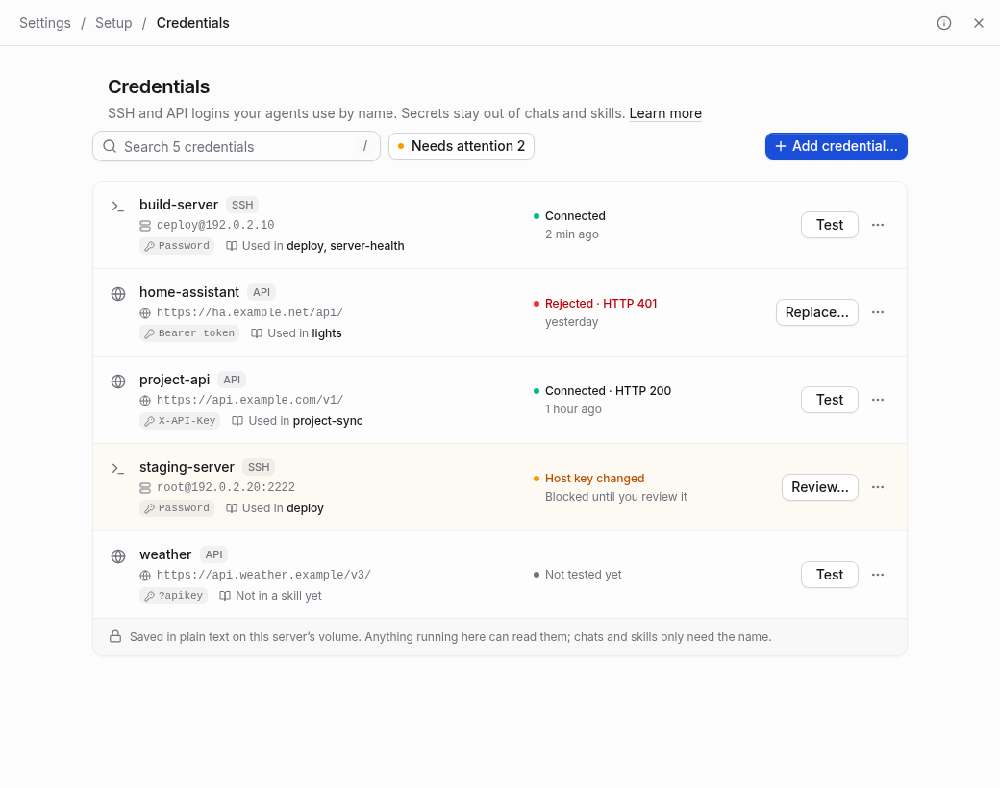

# Credentials

**Setup → Credentials** saves SSH passwords and API keys on this server. Agents
use a credential’s name through `t3-ssh` or `t3-api`, keeping the secret out of
chats and skill files. The page works in T3 Code’s Settings and in the dedicated
Setup console, on desktop and phone.



## Save and test a login

Choose **Add credential…**, then **SSH server** or **HTTP API**. Give it a name
such as `build-server` or `project-api`. Names use up to 64 lowercase letters,
numbers and single hyphens. The name and type cannot change after creation:
skills depend on them. Create another credential to use a different name.

- **SSH server:** enter the hostname or IP address, port, username and password.
  Password and keyboard-interactive sign-in are supported; key-based sign-in,
  multi-step challenges and interactive terminals are not.
- **HTTP API:** enter the complete base URL, including its version or base path,
  authentication method and key. The request preview always masks the key.

| Authentication | Settings | Request |
| --- | --- | --- |
| Bearer token | Saved token | `Authorization: Bearer <token>` |
| Header | Header name and optional value prefix | `X-API-Key: <key>` or `Authorization: Token <key>` |
| Query parameter | Parameter name | `?api_key=<key>` |

Use the service’s required authentication method. Prefer a header when it is
supported: query parameters can appear in the service’s URL logs. OAuth flows,
request signing and WebSocket protocols are outside the HTTP helper’s scope.

**Test** works before saving. A draft test does not save the credential, replace
its password, record a result or change a saved host key. For an API, choose a
relative GET test path such as `account` that requires authentication. A blank
path tests the base URL. A public endpoint can succeed with an invalid key.
Tests report the HTTP status, without exposing the response body or headers.

### Trust an SSH server

The first SSH test reads the server’s public host key without sending the
password. Compare the complete SHA256 fingerprint with the server’s own key
using the command shown in the editor. Then select **Trust this host key** to
test the login. Saving records the login and its approved key separately.
If the final key check fails, the login is still saved, but agents remain
blocked until you review its host key.

Trust belongs to this credential. Neither the test nor the helper silently
accepts a new key or changes your `~/.ssh/known_hosts`. If the server presents a
different key later, **Review…** shows both fingerprints. **Keep blocking** is
the safe default. A reinstall may explain a new key, but verify it through a
trusted channel before choosing **Trust new key**. If the key or saved address
changes during review, you must review the new details again.

Changing an SSH host or port forgets its old trust. **Forget host key…** in the
details menu also blocks future connections until a key is reviewed and trusted.

## Understand a saved credential

The list shows each target, authentication method, last test result and the
skills that mention it. Open its name for connection details, its trusted SSH
fingerprint, commands and a ready-to-paste **Copy snippet** for `SKILL.md`.

Saved tests retain their timestamp and result across reloads. A rejected
password or token offers **Replace…**; a changed key offers **Review…**; a network
failure offers another test. Failed tests and untrusted SSH keys appear in
**Needs attention**, Overview and Setup’s count in T3 Code. A single timeout
does not count as attention; two consecutive timeouts do. Untested API logins
are neutral. Tests only run when requested. Agent helper failures do not update
this history.

**Used in** scans global skills for all seven providers and shared `AGENTS.md`.
It deduplicates shared skill files and looks for literal helper calls with this
credential’s name. It does not scan project-local skills, follow shell variables
or execute files. Results cache briefly and refresh after Setup changes skills
or instructions. If a folder is unreadable or a scan limit is reached, the page
marks usage incomplete rather than claiming the credential is unused.

## Edit or delete

Saved secrets are write-only. **Replace…** accepts a new value; **Keep saved** or
an empty replacement keeps the current value. Show/hide reveals only a value
you have just typed. Closing the editor clears it. Unsaved changes require a
discard confirmation, and a pending test or save blocks repeated actions.

Changes conflict per credential. If another window edits the same login, the
editor shows changed fields and whether the saved secret was replaced. **Use
theirs** adopts the current details and clears your typed replacement if their
secret changed. **Keep mine** retries your draft against that revision. A
credential deleted elsewhere can be **Saved as new**, with a newly entered
secret. Editing a different credential never causes a conflict.

**Delete…** names the skills that may break and explains what is erased. It
removes this server’s saved secret, test history and SSH trust. Skills are not
rewritten, and volume backups may still contain older copies. Deletion does
not rotate or revoke the credential at the remote service.

## Use from a skill or terminal

Both image variants install these helpers:

```sh
t3-ssh build-server -- uptime
t3-ssh build-server -- 'systemctl status app'
t3-ssh build-server -- bash -s < script.sh

t3-api project-api GET projects
printf '%s' '{"name":"demo-project"}' | t3-api project-api POST projects --stdin
```

Replace the credential names and operations with your own. Give a complete
remote shell command as one quoted argument when it contains shell syntax.
SSH stdin remains available for scripts. The helper refuses missing or changed
host trust and directs you to **Setup → Credentials**.

`t3-api` accepts GET, HEAD, POST, PUT, PATCH and DELETE. Paths are relative to the
saved base URL, without a leading slash. `--stdin` supplies a JSON body of at
most 1 MiB. Requests remain under the base URL, verify HTTPS certificates and
never follow redirects. Responses go to stdout; HTTP failures exit nonzero.
The helper adds the saved secret using its configured authentication method.

Helpers filter matching literal, JSON-escaped, URL-encoded, query-encoded and
Base64 secret values from output. This handles accidental echoes, not every
possible transformation. It cannot prevent an agent with shell access from
reading the store. Never put a command that prints credential files or child
environments into a skill.

Adapt the [example skills](../examples/skills) to move existing logins out of
skills. Save, verify and test them before switching commands. Rotate secrets
that previously appeared in chats or skill history; removing the text does not
remove earlier copies. Home Assistant is a bearer-token API, using your own
instance’s base URL ending in `/api/`.

## Storage, migration and recovery

The page’s name changed, but its directory stays
`$T3CODE_HOME/server-credentials/`, normally `/home/t3/.t3/server-credentials/`.
It is owner-only (0700); files are owner-only (0600).

| File | Purpose |
| --- | --- |
| `credentials.json` | Version 2 login records, plaintext secrets, random per-credential revisions and timestamps |
| `state.json` | Disposable saved test results and host-key display metadata, without secrets |
| `known_hosts/<name>` | The single explicitly pinned SSH host key for that credential |

The default home volume preserves these files across restarts, upgrades and
recreations. Mounting only `T3CODE_HOME` preserves them there too. Protect the
volume and its backups: this feature does not encrypt secrets or isolate them
from other processes running as the container user. SSH passes its password to
its askpass child through a child environment.

Setup automatically migrates PR #66’s version 1 store, dropping the separate
label and adding revisions and timestamps. Existing SSH keys from the user’s
`~/.ssh/known_hosts` are carried into each credential’s file and labelled
**carried over**. Missing keys require explicit trust. Migration uses atomic
replacement and makes no plaintext backup; failure leaves the original store
intact. The command-line helpers are read-only and never migrate the store.

The credential’s known-hosts file decides trust. `state.json` is only metadata:
corrupt or missing state does not erase a saved login or grant trust. Tests can
be repeated. An unreadable credential store instead shows an error and stops
writes; it is never treated as an empty list. Restore it privately from your
own valid backup, preserving ownership and permissions. Do not paste it into
an issue, chat or terminal output.

The API uses the console’s existing authentication and same-origin protections.
Serve Setup over HTTPS or a trusted private connection. Secrets and
secret-derived hashes never appear in list responses, `/status`, snippets or
browser storage. The Files page treats the store as a managed path containing
sign-in data.
