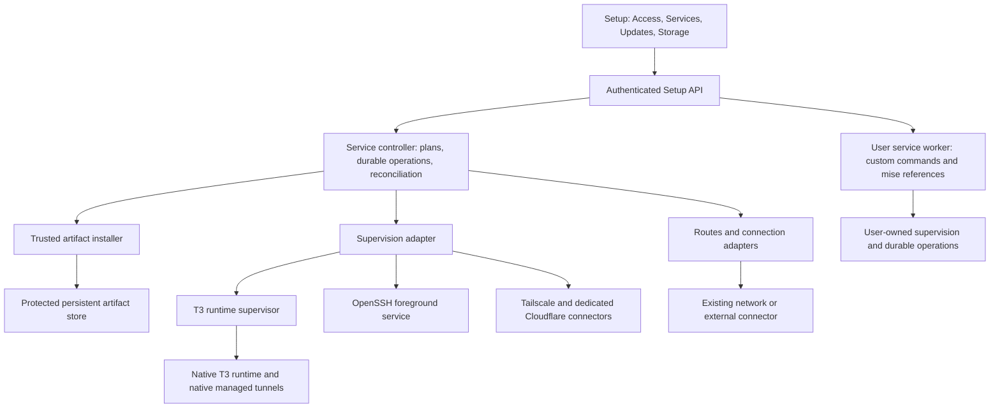

# Optional services and remote access

Status: architecture and acceptance target for PR #119. The interactive prototype is a design reference. The implementation and its current evidence are recorded in [implementation.md](implementation.md); prototype results do not establish backend readiness.

Prepared against `main` commit `844d8504021f7c534851d78e3eabadf7cae5dd26`, after PRs #115 through #118. PR #119 is the motivating SSH proposal. Its head at inspection was `daaed4e346c37db4625087ef8fe0aa85133a7d0d`.

## Product decision

Add a reusable platform for optional, managed services. Make SSH its first consumer and network connectors independent consumers. People should enable a useful capability, understand what changes, and receive a usable connection configuration. They should not need to assemble installers, daemon scripts, port mappings, and authentication state themselves.

Ship the small, trusted control infrastructure in the image. Download optional service payloads only after an explicit enable/install operation, into persistent storage. Keep the existing outbound SSH client, which Git and Vault already use. Preserve existing T3 Connect and port publishing during migration.

The platform supports more than remote access: independently versioned background services, multiple connections, protocol-aware routes, dependencies, credentials, updates, recovery, and diagnostics. Its first release supports both a curated catalogue and custom services using installed mise tools, accessible executables or explicit scripts. Custom code runs as the user account. Arbitrary user-defined root services are outside this contract.

## Deliverables and evidence

- [Interactive prototype](prototype.html), built with the console's existing tokens, components, Inter font, and Lucide icons. All data and operations in it are simulated.
- [Custom-service reference](custom-services.html), opening the same prototype on Services with a sample user command.
- [User journeys and UI contract](ux.md), including empty, working, blocked, failed, and recovery states.
- [Definition and controller contract](definitions.md), showing how future services reuse the same platform.
- [Custom services](custom-services.md), covering arbitrary user-account commands, mise dependencies and the creation/management journey.
- [Acceptance matrix](acceptance.csv), with concrete release gates.
- [Current-console visual grounding](baseline.md), captured from this checkout's fixture console during this design run.
- [Verification record](verification.md), distinguishing prototype validation from unimplemented backend guarantees.

The prototype demonstrates the interaction contract. It does not prove SSH login, tailnet connectivity, privileged installation, or daemon recovery. Those require the integration tests below.

Acceptance matrix notation: **M** means amd64 and arm64, core and browser images, with root-entrypoint and supported rootless cases. A capability explicitly unavailable in one mode must have a tested reason/remedy while core T3 remains usable. Test named/bind/absent/read-only storage, custom UID/GID, ordinary restart and recreate, and the affected runtime version/channel where relevant. **U** means light/dark and custom native palettes; 360/390/820/1440px standalone; compact/wide native embedding; 12/16/20px interface size; keyboard, touch, reduced motion, forced colors, and 200% zoom. Apply the full cross-product to lifecycle and trust-boundary smoke checks, and justify a smaller representative matrix for expensive provider-client end-to-end tests. Every production gate is open; prototype checks do not close backend acceptance.

## 1. Principles that constrain implementation

1. Installed, enabled, running, authenticated, routed, and externally reachable are different facts. Never compress them into a misleading green Connected badge.
2. Every process has exactly one lifecycle owner. UI entry points share the same backend state and operations.
3. Lifecycle failures stay local. An SSH install or connector crash must not cause the supervisor to take down T3 or Setup. Preserve the current contract that an unexpected T3 exit ends the container with its status. Custom processes share account permissions and container resources; this is not a sandbox guarantee.
4. An operation survives its browser, Setup process, and container restart. A retry attaches to the saved operation; it does not repeat an external action.
5. Stop, disable, uninstall, forget identity, and revoke external access are distinct operations with distinct consequences.
6. Review actual changes and dependencies before a disruptive action. Do not ask for confirmation for ordinary reads, checks, harmless retries, or copying.
7. Default to existing network connectivity. A user who already has host Tailscale or a reverse proxy does not need another connector.
8. Preserve the working access path until its replacement is established. Local readiness alone does not establish that replacement.
9. Extend existing console patterns and navigation. Avoid a separate dashboard, terminology, styling system, or service-specific installer UI for each feature.
10. Root-executed binaries, definitions, configuration, and control inputs require a stronger trust boundary than user tools.

## 2. What exists today

| Surface | Verified current behavior | Design implication |
| --- | --- | --- |
| Base image | Includes `openssh-client`, `tini`, Node, and a pinned cloudflared binary | Keep the SSH client. Account separately for optional server payloads. |
| PR #119 | Adds the OpenSSH server through apt at build time; opt-in flag controls startup only | Replace permanent server packaging with a managed service artifact. |
| SSH startup in #119 | Starts a daemon once from the root half of entrypoint | Add ownership, health, retry budget, stop semantics, and durable configuration. |
| Runtime supervisor | Owns the T3 child and transactional runtime update/rollback | Preserve it; do not duplicate or absorb its database protocol into generic service logic. |
| Setup/router | Have separate shell restart loops | Migrate to one supervision policy in a later tested stage. |
| Tool manager | Installs exact mise versions under the unprivileged user's home | Reuse catalogue/operation concepts and UI recipes; never execute that mutable installation as root. |
| Access | Pairing, device list, public URL, and T3 Connect on one page | Retain the Access destination, separate task lanes with tabs. |
| Ports | Uses native T3 managed HTTP quick tunnels | Treat native T3 as their process owner. Preserve its API and version expectations. |
| Tailscale | Documented primarily as an existing host installation | Make external connectivity a first-class supported mode. |

The bundled mise registry inspected in this environment includes cloudflared and has no built-in tailscale, openssh, or sshd entry. A service formula is a new curated installation contract, not a claim that these already work through Add a tool.

## 3. Architecture and ownership



Recommend s6 supervision primitives for generic process lifecycle, with a thin controller for product policy. Keep T3's current supervisor as the T3 service command. The exact PID 1 integration is a phase-zero proof: demonstrate exit-code preservation, process-tree shutdown, rootless startup, and both architectures before choosing s6-overlay versus s6 primitives under the current init. There must be one init owner, not two overlapping signal policies. This is an explicit engineering gate, not an already verified implementation choice.

Protected service supervision runs trusted, foreground commands: `sshd -D -e` through its absolute installed path, `tailscaled`, and named Cloudflare connectors. Custom commands run under the user worker with the same lifecycle policy. The supervisor owns process handles, readiness, bounded retries and stop escalation. Persist PID/start/boot identity for diagnosis, never as permission to signal a PID read from disk. Custom code shares the user's permissions and container resources; supervision is not a sandbox or a guarantee against resource exhaustion.

Ownership classes:

| Class | Lifecycle owner | Console integration |
| --- | --- | --- |
| Managed local service | Generic supervisor | Full install/configure/start/disable/update management |
| Custom user service | User worker with the same supervision engine | Arbitrary user command, mise references, logs/health/configuration/lifecycle; no privilege elevation |
| Native T3 managed tunnel | Native T3 | Adapter calls native API and reports native state; no competing restart loop |
| Host or Compose sidecar | Docker/host operator | Report configured route and observable checks; export configuration; no false local Stop action |
| Per-agent MCP/terminal process | Existing agent/terminal owner | Do not adopt it automatically into Services |

The Setup controller and supervisor communicate through a bounded local protocol. The controller reconciles requested state with observations; UI polling never starts, restarts, installs, or repairs a service as a side effect.

## 4. Domain model

Keep six separate resources with stable IDs and versioned schemas:

| Resource | Owns |
| --- | --- |
| Tool definition | Trusted source, allowed versions, architectures, verification, runtime dependencies, licensing |
| Installed artifact | Verified immutable payload, digest, receipt, active/retained reference counts |
| Service definition | Source/owner, executable/adapter, configuration, fixed execution scope, endpoints, health and lifecycle rules |
| Service instance | Desired state, selected artifact, configuration revision, state/secret references, observation generation |
| Connection | A network provider instance and identity, authentication state, supported protocols and ownership |
| Route | An explicit binding between a service endpoint and a connection; advertised address and evidence |

Operations and verification records are independent resources. A service can have several routes. A connection can serve several services. Removing one consumer cannot stop a shared connection. The first SSH definition supports one `t3` service per container; connector definitions declare their own instance limits. Extensibility does not imply unsafe unlimited tailscaled instances in one network namespace.

Illustrative data, not a finalized wire schema:

```json
{
  "schema": 1,
  "id": "ssh.default",
  "definition": "openssh",
  "desired": { "enabled": true },
  "artifact": { "version": "exact-version", "digest": "sha256:verified-digest" },
  "configurationRevision": 7,
  "generation": 12,
  "endpoints": [{ "id": "shell", "protocol": "ssh", "port": 2222 }],
  "routes": ["ssh.work-tailnet"],
  "lastOperationId": "durable-operation-id"
}
```

Definitions declare protocol compatibility, supported deployment modes, allowed settings, minimum image/controller revision, and update disruption. Capability predicates belong in the shared model and authoritative controller, with stable reason codes. UI visibility is not enforcement.

Add a catalogue service through a trusted definition and installation/configuration adapter. Add a custom service through the unprivileged generic process definition, with user-supplied command/configuration. Neither needs new boot conditionals. Reuse generic plans, rows, inspectors, operation timelines, dependency checks, and update handling. Provide custom sections only where a capability needs them, such as SSH keys or tailnet sign-in.

## 5. Installation and persistence

For catalogue-managed privileged services, use immutable, versioned artifacts built and tested for the image's Debian baseline on amd64 and arm64. Verify signed catalogue metadata and payload digests before extraction. Catalogue definitions and trust anchors are image-owned. Requests to that installer choose approved IDs/versions, never arbitrary download URLs, installation scripts, paths, environment maps, or signing keys. Custom user services reference ordinary installed tools and have a separate user-account execution/store boundary; they do not use or inherit this privileged installer contract.

OpenSSH is not just an `sshd` executable: package required session helpers, runtime libraries, privilege separation configuration, and a tested account policy. An approved artifact may be derived from distribution packages with their provenance retained. No runtime build toolchain or interactive apt transaction is required. Tailscale's official binary distribution is a suitable input, subject to verification and licensing review.

Protected storage layout, provisional names:

```text
/var/lib/t3code/services/               root-owned persistent mount
  controller/                          durable state and operation journal
  artifacts/<tool>/<version>/<digest>/  immutable, root-owned; executable payload readable as needed
  staging/<operation>/                  protected incomplete downloads/extraction
  instances/<id>/                       protected identity, config, secret material
  observations/                        bounded receipts and diagnostics
/run/t3code-services/                   ephemeral sockets, readiness and supervision state
```

Artifact directories are traversable by the service user where necessary. Identity and secret directories remain root-only. They are not all given the same blanket mode. No root executable/configuration is stored beneath the user-writable home. Reject symlinks, traversal, unexpected hard links/devices, and extraction escape; use anchored no-follow filesystem operations and atomic same-filesystem promotion.

The standard Compose deployment declares this small named volume without downloading optional payloads. Existing deployments without a durable protected mount get a precise readiness gate for system services: core T3 remains available, and setup explains the one-time recreate needed to attach the mount. Custom user services use their own persistent user-data storage and do not inherit that system-volume gate. Show a deployment-specific patch preserving all existing environment, mounts, ports, image pin, and runtime selection. Never mount the Docker socket or recreate the container from inside Setup.

A restart is not a recreate. Detect named, bind, and anonymous mounts, do not infer durability from a directory existing. A user may explicitly choose an ephemeral test installation only if the product exposes that mode honestly; it is not the normal persistent setup path.

Before downloading: resolve an exact release; verify architecture/ABI/controller compatibility; calculate compressed, expanded, staging, and rollback disk requirements; check durable storage and network prerequisites. Show measured download/disk values if known, otherwise say they are unavailable. Do not invent size estimates.

Download to staging with bounded retries, verify, unpack, inspect ownership, run a bounded version probe as the intended low-privilege user where possible, fsync, then promote. A partial install is never active. Resume a download only if source identity and verification metadata still match. Otherwise remove only that operation's staging area.

Re-enabling an installed service works without a new download. Pin exact versions, retain the active and previous valid artifact, and coordinate retention with Storage's global cleanup lock. Never delete live, referenced, rollback, identity, or in-flight artifacts. “Clear download cache” cannot erase host keys or tailnet identity.

## 6. Privilege and authorization

Setup remains `t3`. A privileged controller exists only where the root-entrypoint deployment supports it. Its request language is a small allowlist: plan/apply named configuration, install an approved artifact, enable/disable a named service, inspect, and perform a validated update or uninstall. Service-specific code and generated configuration templates are image-owned. No raw shell, arbitrary argv, environment forwarding, PID signaling, filesystem path, or editable root daemon configuration crosses the API.

Custom services use an unprivileged worker with the same lifecycle semantics. Complete privilege dropping before reading their definitions or mise/project configuration. Their arbitrary argv, scripts, directories and child environment go to that worker, never the root API or a root-executed writable supervisor script. Their durable state belongs in the persistent user data home, so rootless custom services do not require the protected system-service mount. See [custom-services.md](custom-services.md) for source namespaces, mise pinning, trust and lifecycle rules.

Authenticate browser mutations using Setup's current key/native-session model and existing same-origin protections. Do not invent an upstream permission scope and assume T3 supports it. Before implementation, map new management operations to an explicit checked authorization policy within the current supported session model. Restricted/anonymous readers must never inherit management access through `/hello` or navigation metadata.

Unix socket peer credentials identify the OS user, not the console or a particular agent. Processes running as `t3` share a trust context, including access to that user's files and many sign-ins. Do not claim a strong agent-versus-Setup boundary. Treat the controller's local caller as potentially hostile and enforce the safe allowlist even if that caller can reach the socket. It must not permit elevating arbitrary `t3` code to root.

Root-started service code must verify every input independently, use a fixed trusted PATH and absolute executable paths, and never read mise/project configuration as root. Revalidate actual account UID/GID after PUID/PGID changes. A request cannot change the service's run-as account, extra capabilities, filesystem roots, or process-owner class.

Use `t3` for ordinary services, and the narrowest reviewed privilege profile for OpenSSH and networking. Do not turn on `T3_ALLOW_SUDO`, add container capabilities, or enable root/password SSH login as a convenience. The first managed OpenSSH release can explicitly require the root-entrypoint mode; rootless support is enabled only after a separately tested account and execution path exists. Rootless T3 and supported unprivileged connectors must continue working independently.

Vault-backed references supply account tokens where the existing Vault policy is suitable. Tailnet machine keys and SSH server identity live in protected service state. Never serialize secret values into status, event streams, URLs we invent, operation plans, logs, exported configuration, or screenshots. Provider-issued sign-in URLs are short-lived credentials: show only in the active authenticated flow, do not place them in global toasts or durable activity. Use supported secret file/descriptor inputs rather than command-line token arguments. Redact before buffering or persistence.

## 7. Lifecycle and reconciliation

State is multidimensional:

| Dimension | Representative values |
| --- | --- |
| Installation | absent, resolving, downloading, verifying, staging, installed, failed |
| Desired state | disabled, enabled |
| Runtime | stopped, starting, ready, restarting, blocked, failed, unknown |
| Authentication | not-needed, required, waiting, authenticated, expired, revoked, unknown |
| Route | absent, configuring, ready, degraded, blocked, disabled, unknown |
| Client evidence | not-tested, observed, failed, stale |

All observations include generation, timestamp, source, and freshness. After control-channel loss, show last-known state with a stale label. Do not optimistically render a stopped service as ready because desired.enabled is true. A disabled service can still be installed and updated.

Every write uses a server-issued plan ID, expected revision, bounded operation kind, and idempotency key. The controller saves operation intent before the first side effect. Repeating a key returns the original operation. A conflicting configuration change produces a clear conflict response, refreshes the impact plan, and preserves the draft. Plan expiry invalidates execution, not the user's form.

Each execution domain has one authoritative durable store for desired state, operations and receipts: protected storage for system services, user-owned storage for custom services. Stable source/operation namespaces identify the owning authority. Setup projects sanitized observations without keeping competing copies. Use durable transactional storage with a defined recovery protocol. SQLite is a reasonable implementation candidate, with WAL/checkpoint/backup behavior tested explicitly. Do not casually reuse T3's own conversation database.

At boot: verify controller schema, identify existing supervised children, reconcile unfinished operations, validate protected mounts and selected artifacts, then converge requested optional state asynchronously. An optional service failure never blocks core startup. UI reconnect attaches to the existing operation ID. Never replay a provider sign-in, route creation, install submission, or revocation merely because its final response was lost. Query its provider/local receipt first; ambiguous external results remain unknown until reconciled.

Backoff starts small, increases to a bounded ceiling with jitter, and has a crash budget. A service that repeatedly fails becomes Failed with a Retry action and a useful cause. It must not restart forever at full speed. Operator Stop/Disable cancels pending restarts before signaling. A core service's critical policy is separate from optional-service restart policy.

Stop the owned process/session group through the supervisor, wait for exit, and escalate after a bounded grace period. Explicitly test grandchildren, SSH sessions, tunnels, and controller exit. Records are cleaned only after the service actually exits. “Continue in background” dismisses the view, never cancels an operation. Cancellation is available only at phases with a defined safe rollback.

## 8. Networking and verification

Connections advertise supported protocols and ownership. T3 Connect is an application connection for T3; it must not appear as an SSH transport without actual native support. HTTP quick-tunnel URLs are not raw SSH endpoints.

| Connection mode | SSH path | Host requirements and truthfulness |
| --- | --- | --- |
| Existing network | Operator-provided reachable host/port or existing connector | Explain exact mapping needed; exported configuration does not mean it has been applied |
| Managed Tailscale | Private tailnet route to local SSH endpoint | Verify selected kernel/userspace forwarding mode; authenticate node; enforce tailnet policy |
| Managed Cloudflare | Explicit SSH route plus Access/client configuration | Explain client `cloudflared`/ProxyCommand or supported private-network alternative |
| External connector | Existing host/sidecar reaches container endpoint | Observe what is testable, label external ownership, keep its lifecycle outside the local controller |

For a co-located connector that can proxy loopback, bind SSH to loopback and publish no Docker SSH port. A host/sidecar connector may require a container-interface listener and an explicit host mapping. Export the correct configuration for that topology; a Docker host loopback mapping cannot reach a service bound only to container loopback. Account for other containers on the same network when describing exposure.

Tailscale kernel mode may require TUN and capabilities supplied when the container is created. Userspace mode has different routing semantics and must be proven for the exact incoming TCP/Serve path; do not assume a SOCKS proxy makes an inbound SSH endpoint. Installing a binary cannot grant a missing container device or capability. Give a capability-specific remediation or a supported alternative.

Cloudflare SSH requires a protocol-aware route, account/hostname setup, and usable client configuration. Keep ordinary SSH key authentication unless an explicit, separately reviewed certificate or Tailscale SSH model is chosen. Installing a tunnel does not waive SSH authorization.

Verification has three separate checkpoints:

1. **Service ready:** validated configuration, correct process identity, SSH handshake at the expected local endpoint. This is not a user login test.
2. **Connection ready:** connector authenticated, correct route bound, fresh provider/local status. This does not establish external reachability from the user's laptop.
3. **Device verified:** an authenticated client performs a bounded challenge over the selected route, or equivalent correlated evidence establishes it. Store its vantage, route/config generation, time, and method. An ordinary login observed without route proof is labeled “SSH sign-in observed,” not “Tailscale path verified.”

Success after steps 1 and 2 says “Ready to connect” and offers client configuration. It must not say “Connected” until there is relevant evidence. A browser HTTP probe cannot test raw SSH. Route/key/identity changes invalidate old verification. Local checks, provider API checks, and client checks report their limits independently.

Avoid arbitrary URL/SSRF probes: checks target declared local endpoints or approved connector APIs, have time/body limits, and cannot accept caller-supplied privileged destinations. External connector ownership never authorizes changing host networking from the container.

## 9. SSH-specific contract

- Public-key authentication for `t3`; root/password/keyboard-interactive login disabled. Handle account lock/PAM behavior correctly without introducing password access.
- Invoke OpenSSH through an absolute trusted path. Package and test the required session helpers. Validate the complete generated configuration before starting.
- Root-owned persistent host identity; never regenerate a valid private key just because its public sidecar is missing. Recover the public key and verify their match. Corrupt/mismatched identity requires an explicit repair decision, not silent replacement.
- Store authorized public keys as structured entries with label, fingerprint, added/last-observed time, and revision. Validate with OpenSSH tooling and preserve supported key options only through an allowlist. A private key pasted into the public-key field is rejected without logging it.
- Key removal blocks future authentication. Existing sessions may remain. Offer a separate explicit termination action when supported; never imply that removing a key disconnects all sessions.
- The server never requests, stores, or generates the user's client private key. Client IdentityFile is an optional local configuration choice.
- Show the server's public fingerprint and a verified known_hosts entry. Never suggest disabling host-key verification to make setup work. Host identity changes have a clear recovery path and provenance.
- Reject conflicts with actual T3, Setup, single-port, and managed listeners, including customized ports. Validate ownership, range, normalized numeric values, and service endpoints again under the operation lock.
- Verify interactive terminals, noninteractive SSH commands, SFTP, VS Code installation, and the VS Code extension host/toolchain environment. Sourcing a login profile alone is insufficient.
- The selected T3 home, workspace, persisted agent configuration and installed toolchains must agree across T3 terminals, `docker exec`, and SSH. Do not export the entire container environment or credentials into SSH sessions to achieve this.
- Agent forwarding stays off initially. A future explicit option needs a clear explanation and security review; it is not required just because VS Code can use it. TCP forwarding required by the supported Remote-SSH mode is enabled deliberately and tested with its real socket/port options.

## 10. Safe changes and recovery

Before change, compute an authoritative impact graph: affected services, routes, sessions where measurable, dependent consumers, restart/recreate needs, data retention, and current access path. Unknown session counts or route attribution stay unknown.

Do not promise uninterrupted SSH/connector updates. Validate a candidate's configuration offline and, where possible, probe it on an isolated temporary endpoint. A single port or tailnet identity cannot always run two copies concurrently. Stop/replace/start is a measured outage; on readiness failure, restore the previous artifact/configuration and report the outcome. A successful rollback says the previous version is running, not “Update succeeded.”

When replacing a connection, keep the old route until the new one has suitable external/client evidence. Save a durable fallback and a bounded recovery deadline where applicable. A server-local probe must not commit a migration that can strand the operator. Disabling a sole known path requires a clear impact review and an identified fallback; attribution uncertainty must be stated. A timeout is never consent to remove access.

| Action | Behavior |
| --- | --- |
| Stop for now | Stop current run, suppress automatic restarts until next explicit start or declared restart policy; label whether next container start resumes it |
| Disable | Persist off; remove/deactivate owned routes; stop service; retain artifacts/configuration/identity |
| Disconnect account | Stop dependent routes and service as needed, request provider logout/revocation, reconcile provider outcome separately |
| Uninstall | Block while required by another consumer; stop and remove payload references; retain identity/configuration by default |
| Forget identity/data | Separate explicit destructive action after dependencies and provider cleanup are reconciled |

Use precise labels in UI. Prefer Disable for the common durable action; keep temporary Stop in the inspector with its policy explained. Stopping the UI controller must never accidentally convert Disable into a restart.

## 11. Operations, diagnostics, updates and storage

Operations have immutable ID, initiator metadata, target revision, plan hash, phase, start/finish times, bounded progress, checkpoints, stable error code, redacted detail, and recovery result. Emit sequenced events with replay or equivalent resumable reads. A dropped event stream falls back to status-by-ID; it does not resubmit the mutation.

Progress names real work: Checking requirements, Downloading, Verifying, Installing, Waiting for sign-in, Starting, Checking route, Ready to connect. Percentages only appear for measured quantities. Indeterminate phases use a spinner and elapsed time. Provider approval waits are not stuck at 99%.

Logs are bounded and rotated; known secret values are redacted before buffering or writing. Keep human-readable causes and operation receipts, not complete environments or token-bearing command lines from managed adapters. Diagnostics use a previewable export; public keys/fingerprints and hostnames have their own privacy treatment even when they are not secrets. System adapters never emit private machine keys. Arbitrary custom applications can print unknown sensitive content, so generic output cannot be promised secret-free; its export needs explicit preview and existing access controls.

Updates uses the existing Updates page and policies. Show exact current/target version, source, verification, dependents and expected disruption. Service updates default to manual review, especially for the active remote-access path. A generic Update all must not silently restart the only access connector. Preserve existing T3 version/channel selection. Formula/controller/image compatibility blocks an unsafe downgrade after an image rollback; core T3 remains usable and the service reports why it is blocked.

Storage shows optional payloads, retained versions, temporary downloads, logs, and identity separately. Uninstall/cleanup plans use the same dependency graph and locks. Backup/export distinguishes a safe configuration export from an encrypted protected-identity backup. Restore of tailnet state must prevent duplicate simultaneously active nodes; restore of host identity must preserve fingerprints and permissions.

## 12. Information architecture and UI standard

Keep **Access** in its existing home position and phone tab. Add **Devices**, **Connections**, and **SSH** tabs; `#access` continues to Devices. New searchable deep links include `#access/connections`, `#access/ssh`, `#services`, and an ID-based service inspector. Preserve parent navigation, browser history, drafts, scroll and focus across updates.

Connections contains existing Public URL and T3 Connect plus optional providers. Devices retains pairing and revocation behavior. SSH owns incoming SSH keys, connection instructions, and direct links to its service/connection. Vault's existing SSH entries remain clearly labeled outbound server credentials; they do not silently authorize incoming login.

Services sits under System, with Configured/Available/Needs attention views, search, consumer labels, exact version, state, and one next action. Add service offers catalogue and custom-service creation. Custom rows identify their source and run-as account, with shared logs, health and lifecycle actions. Users can finish SSH setup without visiting Services. It is the common management surface, not a second independent set of toggles.

Use existing `T3Routes`, model functions, Kit layers, `tc-` rows/groups/controls, tokens, Lucide marks, standalone/embedded appearance bridge, command palette, toast and inline feedback rules. No new font, card language, primary color, onboarding hero, or second modal stack. Backend implementation terms such as formula, PID, daemon, ABI, and supervisor belong in advanced details or diagnostics, not the primary setup flow.

Re-use the current side inspector on wide screens and the existing compact/full-height presentation on narrow/embedded screens. The prototype uses a bounded native dialog to demonstrate the form flow; production must use Kit and the native host's inert/backdrop coordination. Do not copy the prototype's demonstration controls into production.

Acceptance includes light/dark/system/custom native palettes, 12px to 20px native interface sizing, 360/390/820/1440px standalone, compact/wide embedded Settings, keyboard navigation, reduced motion, forced colors, long labels, zoom and screen-reader announcements. See the detailed [UI contract](ux.md).

## 13. Delivery sequence and decision gates

| Phase | Concrete deliverable | Exit evidence |
| --- | --- | --- |
| 0: prove hard constraints | Supervision and user-worker privilege drop; isolated mise resolution; OpenSSH artifact; Tailscale inbound route; authorization and rootless matrix | Real amd64/arm64 image tests, hostile custom-command tests, SSH/VS Code smoke, shutdown/fault evidence |
| 1: shared foundation | Protected system store, persistent user store/worker, trusted catalogue, durable operations and supervisor adapters | Privilege-drop, crash/recreate/idempotency/hostile-input tests; no core behavior change |
| 2: first features | Optional SSH over existing network, Access tabs, Services inspector, custom commands and mise integration | End-to-end login and custom-service lifecycle; tool retention, rootless and required UX matrix |
| 3: connectors | Tailscale and named Cloudflare connections/routes | Account expiry/revocation, shared dependencies, route replacement and lockout recovery |
| 4: consolidate | Setup/router supervision migration; lazy cloudflared resolution for native T3 | Preserve T3 lifetime, native tunnel ownership, pinned compatibility and existing Ports/CLI behavior |
| 5: expand | More reviewed service definitions using unchanged contracts | At least one non-SSH service proves catalogue/inspector extensibility without core branching |

All phases belong to the full design. Staging reduces simultaneous risk; it is not permission to label an incomplete phase fully delivered. PR #119 should be reframed around the approved first implementation slice, with its original useful SSH constraints preserved. No merge is authorized by this design artifact alone.

Unresolved engineering proofs are explicit: supervision/PID 1 choice, user-worker privilege dropping and isolated mise resolution, OpenSSH artifact provenance and dependency closure, inbound userspace routing behavior, and the currently supported native-session management authorization mapping. Resolve them in phase 0; no UI claim or implementation shortcut may assume they passed.

## 14. Sources and traceability

Repository grounding: `Dockerfile`; `docker/entrypoint.sh`; `docker/runtime/supervisor.mjs`; `docker/runtime/supervision.mjs`; `docker/setup/server.mjs`; `docker/setup/client/routes.js`; `docker/setup/design/README.md`; `docker/setup/design/{tokens.css,components.css,ui.js}`; `docker/harness/{catalogue.mjs,packages.mjs,lock.mjs}`; `docs/{remote-access.md,ports.md,toolchains.md,storage.md}`; PR #119's diff.

External constraints:

- [Cloudflare SSH with client-side cloudflared](https://developers.cloudflare.com/cloudflare-one/networks/connectors/cloudflare-tunnel/use-cases/ssh/ssh-cloudflared-authentication/): protocol-aware route and client ProxyCommand requirements.
- [Tailscale userspace networking](https://tailscale.com/docs/concepts/userspace-networking): userspace versus kernel network behavior.
- [Tailscale container deployment](https://tailscale.com/docs/features/containers/docker): separate container/host deployment options.
- [Portable OpenSSH installation](https://github.com/openssh/openssh-portable/blob/master/INSTALL): dependencies and runtime account configuration.
- [s6 documentation](https://skarnet.org/software/s6/overview.html): supervision primitives; candidate, pending the phase-zero proof.

## Review outcomes required before implementation

The implementation proposal must answer with evidence: who owns each process, what runs as root, where each executable and identity persists, what happens after every interrupted operation, which path a client actually tested, and how the operator recovers if their active route fails. UX review must establish that a person can enable, connect, diagnose, update, disable, and uninstall without guessing what the state badge means.
