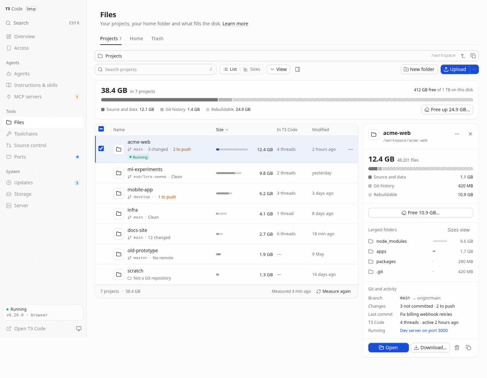

# Files

Open **Files** under Tools in Setup, or press **G F**. Projects lists every visible
folder at the top of `/workspace`; a workspace that is itself a Git repository
appears as one project. Home opens the persistent home folder, with hidden files
shown by default.

<picture>
  <source media="(prefers-color-scheme: dark)" srcset="media/files-dark.png">
  
</picture>

## Browse and inspect

Use **Go to folder** (**Ctrl/Command L**) to open another absolute path. Files has
the same filesystem permissions as t3’s terminals. It does not use sudo and does
not restrict browsing to the workspace or home folder.

Select a row to inspect it; double-click a folder to open it. On a phone, tap to
open and hold for actions. View offers hidden files, sorting, selection and Sizes.
Search matches names inside the current folder and its descendants, with type,
size and modification filters. It never executes a file.

The location bar uses a full row so long paths have room. Search and actions sit
below it, with **New folder** and **Upload** together. In compact consoles,
**View** also offers **List** and **Sizes**. File names stay above ownership and
safety labels; Details keeps the full path and modification time available.

Folder sizes show allocated disk space; files show their length. Files reuses
Storage’s existing scan, with a small cached directory index. Missing sizes are
measured in the background, two folders at a time, for up to 20 seconds each.
Unknown sizes remain unknown; a partial measurement is marked as an estimate.
**Measure again** refreshes the current folder, or starts Storage’s scan at the
Projects and Home roots. Git facts are local reads, bounded and cached; no fetch,
hooks or fsmonitor commands run. Repositories that apply executable content
filters report Git status as unavailable, so browsing never runs those filters.
Submodule working-tree changes are not inspected; their own folder can be opened
for its Git facts.

Rebuildable folders use known build/install directory names. Inside a Git
repository they must be ignored and contain no tracked source. Elsewhere a
matching project marker is required. Size bars hatch this part and name it in
text, without depending on colour alone.

Text previews are limited to 1 MiB and 200 displayed lines. Image previews allow
up to 25 MiB and PDFs up to 50 MiB. Secret values start hidden. Single-file
downloads are served as sandboxed attachments; opening HTML or SVG does not run
it as console code. Managed folders identify the pages that own them. Operating
system permissions still decide what can be read.

When the running T3 version exposes project roots and thread summaries through
its supported RPC, project details include thread activity. Files never reads
T3’s database. Unsupported runtimes omit this information.

See [Storage](storage.md) for cache and tool-version maintenance.

## Change files

Create folders and rename items in place. Move to opens a destination picker;
copy keeps the originals. Same-mount moves can be undone for five minutes if
nothing has changed since the move. Replaced destinations are kept in Trash.
Cross-filesystem moves copy into private staging, verify the source, then publish
complete copies before removing the originals. Two server jobs run at a time.

Trash is per filesystem, merged into one view. Workspace items use
`/workspace/.t3-trash`; home items use `~/.t3/trash`. A symlink is moved as a link.
Restore keeps any conflicting name by adding `(restored)`. Items expire after
seven days; disk pressure at 90% removes the oldest until usage is below 85%,
while preserving the first ten minutes for Undo. Empty Trash requires a fresh
confirmation. Other mounts have no implicit Trash. Select items for **Restore**
or **Remove selected…**; on a phone, use **Select items** in View. Trash selection
offers recovery and removal instead of file-editing or transfer actions.

Upload files, a folder, clipboard files or a desktop drop. At most three files
upload together in ordered 8 MiB chunks. Received data stays under a private
staging name until completion. The server reserves 1 GiB of headroom. The tray
shows progress, recovery, conflicts and completed files; phones use a sheet.
Choose the same name, size and modification time in the same destination to
resume after reopening the console. Unfinished sessions expire after 24 hours.
Conflicts offer Replace (the old file goes to Trash), Keep both or Skip.
A lost finish reply is checked against the server's saved result, never replayed
as a fresh upload. Empty folders from desktop drops are preserved.

The editor supports valid UTF-8 text up to 5 MiB. Drafts live only in this tab;
refresh polling never replaces an unsaved draft. Secret values remain masked
except on the line being edited. A stale save offers Discard mine, Save as a
copy, Overwrite theirs and Compare. Saves use a synced temporary file, preserve
the mode and publish by rename. The console never executes the edited file.

Managed folders begin locked. Editing actions are muted while previews and
downloads stay available; the menu explains the restriction. **Edit anyway**
unlocks only the named managed root until you leave it; **Lock again** ends that
permission immediately. Phone selections and keyboard shortcuts respect the
same lock.
Sign-ins and keys have separate consequences. Process checks fail closed when
activity cannot be established. For a supervised T3 process, **Stop T3 Code
first** pauses it for the change and verifies that it restarts. Other processes
must be stopped in their terminals. Setup remains available during this pause.

## API and permissions

The authenticated `/files/*` API uses absolute paths and the same permissions as
the UI. Writes require same-origin requests. JSON bodies are limited to 64 KiB,
except `/files/write` (5 MiB + 64 KiB); raw upload chunks allow 8 MiB. Managed
writes carry `unlock` equal to the managed root, and sign-in/key changes require
`confirmed: true`. `requestId` deduplicates editor, rename, mkdir and move replies
within a bounded five-minute window. See the Files tests for request examples.

## ZIP downloads and archives

Download a folder or a selection as a ZIP. Review its contents first: leave out
rebuildable output, include Git history, and include hidden files. Hidden files
can contain credentials; the review names sensitive entries so you can keep the
download private. ZIP output streams to the browser with backpressure and no
large in-memory archive. Two streams can run at once; closing a download cancels
its worker. **Compress** instead creates a ZIP beside the selection, choosing a
new name when one is already there.

Select a ZIP to see its expanded size and top-level entries. **Extract** offers a
new folder by default, or **Here** with Replace, Keep both and Skip for each
conflict. ZIPs with more than 500 top-level items use a new folder to keep the
review bounded. Replacements go to Trash. Moving the original ZIP to Trash after
extraction is optional and starts off. Finished ZIP uploads also offer an
unchecked **Extract into …/** shortcut; unsafe entries or naming decisions open
the full review first.

Extraction supports Store and Deflate, including ZIP64 and legacy CP437 names.
Encrypted, split and other compression formats need a local archive tool.
Reviews allow up to 200,000 entries and 64 MiB of directory metadata, with a
20-second inspection budget. Unsupported or damaged archives explain why they
cannot be extracted. A low-space preview keeps its contents visible and disables
Extract until the disk can keep 1 GiB free after expansion.

Archive names are parsed from record lengths, not line-oriented CLI output, so
newlines and Unicode names stay unambiguous. Absolute paths, `..`, backslashes,
special files and unsafe links are disclosed and skipped. Links must resolve
inside the ZIP's own namespace; dangling or cyclic links are skipped too. If
Here would separate linked entries through Skip or Keep both, use a new folder.
Each entry is streamed into private staging with exact declared-size and CRC
checks; links are created last. No extracted item is published until these
checks pass. Cancellation removes only the operation's own recorded stage.
Compression workers have a 20-minute hard limit.

## Free up project space

Choose **Free up …** in Projects, a project's details, or View. The review groups
rebuildable folders by project, shows what recreates each one, and keeps Git
tracked files and uncertain candidates. Folders used by running processes start
unchecked and cannot be selected until those processes stop and the review is
refreshed. Unknown activity also keeps the folder. Cleanup removes the reviewed
build output permanently; source and Git history are preserved.

The selected total is an estimate from the last measurement. Unknown sizes stay
unknown. A cleanup carries on when its review closes; Transfers shows progress
and the result. Run the project's install or build to recreate removed output.
When the disk is nearly full, Files links to Sizes, Free up space and Empty Trash.
Storage's **Container data → Folder sizes** links back to Files for Projects,
T3 Code data and backups.

## Permanent deletion

Prefer Trash when you may need to restore an item. **Delete permanently…** or
**Shift Delete** opens a separate review. Projects show local-only commits,
uncommitted files, running processes and T3 thread references where available.
Download first to keep a copy. The exact project name—or `DELETE N ITEMS` for a
mixed project selection—must be typed; Enter never confirms deletion. Stop
processes using the selection and review again before deleting it.

Permanent deletion cannot remove `/`, the workspace, home, a managed root or an
ancestor of Setup's own state. This remains true after Edit anyway. It cannot
remove mounted filesystems. Sign-in and key folders show their consequences.
There is no Undo; partial failures keep completed changes visible and ask you
to inspect the folder before another review.

## Review and restart behavior

ZIP downloads, extraction, Free up space and permanent deletion use single-use
reviews that expire after five minutes. Actions recheck the reviewed files,
Git/activity facts and destinations before starting and again when queued work
runs. A stale review removes nothing; **Review again** loads current facts.
Network failures never silently replay a write. Use Transfers and the folder to
confirm the outcome before another action.

The server keeps at most 64 reviews, 128 queued/running jobs and 100 completed
jobs. ZIP metadata is cached by file revision with an eight-archive/250,000-entry
bound. All metadata, walks and archive output have explicit limits. Private
staging journals identify the exact directories this operation created; after
Setup restarts, interrupted work is reported and only those stages are removed.
A filename prefix alone never authorizes cleanup. Reviews do not survive a
restart. User files, credentials and editor drafts are never stored in review
metadata.

For scripts, authenticate as for the other Setup APIs. Preview replies contain
`token` and `expiresAt`; send the token with the selected choices, rather than
reconstructing a review from cached UI data.

| Operation | Review | Start |
| --- | --- | --- |
| ZIP download | `POST /files/zip/preview` with `paths` and `options` | `POST /files/zip/start` with `token`; download `GET /files/zip?token=<returned download token>` within 30 seconds |
| Extract | `POST /files/extract/preview` with `path` | `POST /files/extract` with `token`, `into: "new"` and `name`, or `into: "here"` and per-name `choices` |
| Free up space | `POST /files/clean/preview` with `path` | `POST /files/clean` with `token` and the selected candidate `ids` |
| Delete | `POST /files/delete/preview` with `paths` | `POST /files/delete` with `token`, `confirmName` when required and `confirmed: true` |

`POST /files/compress` takes `paths` and an optional archive `name`; it keeps the
originals. Start replies name a `job`; `GET /files/jobs` supplies its progress and
result. `POST /files/jobs/cancel` takes `id`. A job whose `cancellable` flag is
false is finishing its publication or removal and must be allowed to finish.
Treat `stale` as a new review and `busy` as a wait; never replay an action after
a lost reply. All these endpoints retain Setup authentication and same-origin
write checks.
