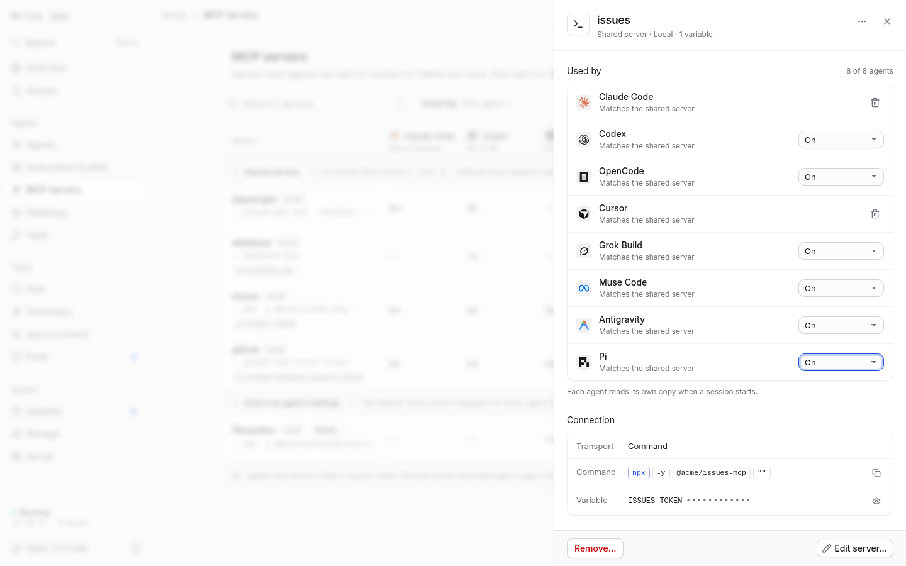

# MCP servers

Open **Setup → MCP servers** (or press **G**, then **M**). Define a local
command or Streamable HTTP server once, then choose which installed agents
receive it. Setup never starts a command, connects to a server or signs in for
you. Each agent loads its own copy when a new session starts.

## The library

The page compares shared definitions with the agents’ global settings. Search
names, commands or URL origins; filter by agent or **Needs attention**. **Rescan**
reads the current files. Status polling leaves open menus, focused controls and
form drafts alone. On phones the matrix becomes a grouped list, with agent
filters and an Add server action above the safe area.

**Shared servers** are defined in `$T3CODE_HOME/setup/mcp/servers.json`. **Only in
an agent’s settings** lists entries already configured outside Setup. Share one
to manage it here. Unsupported entries remain visible and stay unchanged.

| Cell | Meaning and actions |
| --- | --- |
| On | Matches the shared definition and is configured to start in a new session. |
| Off | The agent keeps the entry but does not start it. Its content still matches. Available in Codex, OpenCode, Grok, Muse, Pi and Antigravity. |
| Differs | The native copy has different fields or agent-specific options. Review before replacing it. |
| — | Not added. Use Add to copy the definition into this agent’s settings. |
| Own entry | Native settings contain this server; it has no shared definition yet. |

These states describe configuration, not connectivity. Unreadable settings get
an attention notice and disable that agent’s controls. While a change saves, its
cell shows progress and that agent’s column is disabled; other agents remain usable.

The **Installed agents / All agents** menu beside **Server** controls the matrix
columns, as it does in Skills. It stays visible when the table scrolls sideways.
All agents also shows uninstalled agents; their saved entries are read-only.
All eight agents support native global MCP configuration.
Changing the visible columns never adds a server or changes native settings.

<picture>
  <source media="(prefers-color-scheme: dark)" srcset="media/agent-resources/mcp-dark.png">
  
</picture>

Claude Code and Cursor have Add/Remove here. The other six agents also support
On/Off. Claude’s per-project toggles are outside Setup’s inventory. A legacy
shared `enabled: false` value is still readable and makes new copies with On/Off
start off; it no longer blocks adding a copy to Claude or Cursor.

## Add, edit and share

**Add server…** accepts Claude/Cursor, Muse, Pi and Antigravity JSON, Codex/Grok
TOML, OpenCode V1/V2 JSON, a `claude mcp add` command, a plain command line or an HTTP URL. Nothing
pasted is run. When several servers are found, choose one and add the others
later. Placeholder values get a warning; replace them with your own credentials.
Variable references remain literal and follow each agent’s own rules.
Existing Muse `mcp_servers` sections and Antigravity direct server maps retain
their native layout when adding or removing a server. Both layouts can also be
pasted directly, as can a single native server entry.

Command lines use quoting without shell expansion. **Edit one per line** provides
one field per argument and preserves empty arguments, surrounding whitespace and
line breaks. It is selected automatically for values that need it. Local and
remote drafts stay separate when you switch transport. Environment and header
values are masked by default; multiline values remain intact. Pasting `KEY=value`
lines into a variable name adds rows.

The **Use in** rail reviews which settings files will change. A same-name native
entry is unticked by default when adding; replacing it requires consent. A failed
snippet leaves the current form intact. Late parsing results do not overwrite
manual edits made while parsing was pending.

**Edit server…** saves the shared definition, then updates checked agents in
sequence. Agents that matched are selected by default. Differing copies require
an explicit selection; unchecked agents keep their copy and show Differs after
the shared definition changes. Agents already Off stay Off. Names cannot change:
add a server under the new name, then remove the old one.

**Share…** reads the native versions for a server. Choose a source when they
differ, then consent before replacing another agent’s entry. Secret values are
copied as they are. Options the shared format cannot hold are listed as dropped;
the source file stays exactly as it is. Creating or replacing the shared
definition never writes an agent’s file by itself.

Saves block dismissal and navigation until their results arrive. Closing an
unsaved form asks whether to discard it, and reload warns while a draft or save
is pending. A partial save reports exactly which agents succeeded and keeps a
result view for failures. Review current settings before trying again; successful
writes are already saved. A revision conflict requires a fresh review.

## Inspect, update and remove

Open a shared server’s name or **Review…** to see each agent’s copy, its saved
location and a field-by-field difference. Environment/header differences show key
names and whether values differ, never secret values side by side. Connection
values are revealed only on request and are not announced in a live region.

**Update to shared** replaces the complete native entry, including agent-specific
options. A menu asks for confirmation; the inspector already shows the reviewed
differences. Removing a matching copy offers revision-checked Undo, preserving its
Off state. Removing a differing copy asks for confirmation because its own edits
would be lost. Each changed settings file gets a private backup beside its
resolved target (`.t3-mcp-backup.<unique suffix>`).

**Remove…** lists every supported agent that still has the server, including
differing copies. It unlinks them in sequence and deletes the shared definition
last. If one write fails, removal stops, the definition remains and the dialog
shows the failure and remaining copies. An unreadable settings file blocks
removal, so an unknown copy is never silently left behind. Existing sessions may
keep using a removed server until they end.

## Sign-in and scope

OAuth is separate for each agent. If a remote server asks to sign in, use the
command shown in its inspector from a T3 Code terminal:

```sh
claude mcp login SERVER_NAME
codex mcp login SERVER_NAME
opencode mcp auth SERVER_NAME
cursor-agent mcp login SERVER_NAME
muse mcp login SERVER_NAME
pi mcp login SERVER_NAME
```

Native approval, project configuration, custom T3 provider profiles, enterprise
policy and effective runtime discovery remain with the agents. Grok and
Antigravity authentication uses their native MCP interfaces. SSE-only addresses cannot
be imported as portable HTTP servers; use the server’s Streamable HTTP address.

## Files and safety

The store is owner-only (0600), limited to 128 servers and 256 KiB. Native files
have a 1 MiB read/write limit. Every native write checks the shared and provider
revisions, runs through the same native-settings queue as Skills, preserves
symlinks and unrelated settings/comments, and publishes atomically. Backups hold
secret values; remove them manually when no longer needed. This is optimistic
concurrency, not a cross-process transaction against other applications.

Polling and list responses expose environment/header key names and counts, and
remote URL origins only. Full URLs and credential values load through
authenticated detail reads. Commands are visible in lists, so put credentials in
Environment or Headers. URL userinfo is rejected. The snippet parser is pure,
limited to 64 KiB, and performs no execution, expansion, network calls or writes.

| Provider | Native global config | Support in this release |
| --- | --- | --- |
| Claude Code | `~/.claude.json`, or `$CLAUDE_CONFIG_DIR/.claude.json` | Local command/args/env and HTTP URL/headers |
| Codex | `$CODEX_HOME/config.toml` (default `~/.codex/config.toml`) | Local and HTTP; native `enabled`; full TOML parsing with edits limited to the selected server |
| OpenCode 1 | `opencode.json[c]`, `.mcp[name]` | Local and HTTP; native `enabled` |
| OpenCode 2 | `opencode.json[c]`, `.mcp.servers[name]` | Local and HTTP; native `disabled`; existing native V2 files stay V2; new files use the V1-compatible format also accepted by V2 |
| Cursor | `~/.cursor/mcp.json` | Local and HTTP; native approval/login still applies |
| Antigravity | `~/.gemini/config/mcp_config.json` | Local and HTTP; `serverUrl` and `disabled`; normalized into T3's private profile before launch |
| Grok Build | `$GROK_HOME/config.toml` (default `~/.grok/config.toml`) | Local and HTTP in `mcp_servers`; `headers`, `enabled` and `disabled_mcp_servers`; connected gateway profiles refreshed after saves |
| Muse Code | `$XDG_CONFIG_HOME/muse/settings.json` (default `~/.config/muse/settings.json`) | Local and HTTP in `mcpServers`; `enabled`; preserves schema version 1 and an existing legacy `mcp_servers` section |
| Pi | `$PI_CODING_AGENT_DIR/mcp.json` (default `~/.pi/agent/mcp.json`) | Local and HTTP in `mcpServers`; `enabled`; requires Pi 0.99.0 or later |

Older Pi versions do not load native `mcp.json`. They show an update message and
cannot receive new copies until updated; existing files remain untouched. The
reserved Pi server name `t3-code` belongs to T3's orchestration extension.
Grok server names must start with a letter.

The installed Antigravity ACP loader reads remote servers from `url` and does
not honor `disabled`. T3's bridge therefore creates a private snapshot that
maps `serverUrl` to `url` and omits disabled servers. It refreshes at session
startup, preserves private credentials and hooks, and removes its own stale
snapshot when the global source is deleted. Private or manually edited profile
resources are preserved and reported as a launch conflict with their path.
The bridge ships with the maintained Stable and Nightly runtime patches.

Claude HTTP entries require an explicit transport type; a URL alone is
reported as differing. The documented `streamable-http` alias is recognized.
OpenCode JSONC wins if both files exist. V2 global options are preserved even
when the config has no server dictionary yet. Entries using the other layout's
state flag (`enabled` in V2 or `disabled` in V1) show **Differs** until applied
with the correct flag. Codex uses a pinned vendored TOML
syntax tree; nested tables, arrays of tables and unrelated comments are preserved.
All provider writes share the native-settings serialization queue with skills,
follow existing file/directory symlinks, reject stale revisions/retargeting and
publish atomically with owner-only permissions. Other applications can still
race between the final check and rename; this is not a cross-process transaction.
The page manages default global files, honoring the server environment’s
Claude/Codex/XDG/OpenCode/Grok/Pi directory overrides. With credential persistence enabled,
all default resources, including Claude's `.claude.json` and Antigravity's
global config, live on the state volume. Custom roots need
their own persistent mounts.

`t3-browser-mcp` remains a separate quick CLI path for the bundled browser
servers. It writes native entries directly and does not create shared definitions.

## Verification

Run `node --test tests/mcp*.test.mjs tests/full-agent-resources.test.mjs tests/agent-resources-patch.test.mjs` for parsing, per-agent state, adoption,
revisions, redaction, format preservation and the authenticated API boundary.
`node scripts/mcp-ui-audit.js URL KEY` exercises desktop, phone and embedded flows
in both themes with synthetic data. All API mutations are intercepted.

`node scripts/mcp-native-smoke.mjs PROVIDER /absolute/path/to/executable` verifies
local/HTTP handshakes, credential delivery, unlink and native Off/On using
fresh native reads, disposable homes and fixture servers. It never sends model
requests to an external provider or uses real credentials. Muse uses its local
echo provider. This checks native configuration and MCP negotiation,
not model-selected tool calls or OAuth.

Native contracts: [Claude](https://code.claude.com/docs/en/mcp),
[Codex](https://learn.chatgpt.com/docs/extend/mcp?surface=cli),
[OpenCode V1](https://opencode.ai/docs/mcp-servers/),
[OpenCode V2](https://dev.opencode.ai/v2/docs/mcp-servers/),
[Cursor](https://cursor.com/docs/cli/mcp),
[Antigravity](https://antigravity.google/docs/mcp/),
[Grok](https://github.com/xai-org/grok-build/blob/main/crates/codegen/xai-grok-pager/docs/user-guide/07-mcp-servers.md),
[Muse](https://meta-models.github.io/muse-code-sdk/next/guides/extend/mcp-servers/),
and [Pi](https://github.com/earendil-works/pi/blob/main/packages/coding-agent/docs/mcp.md).
