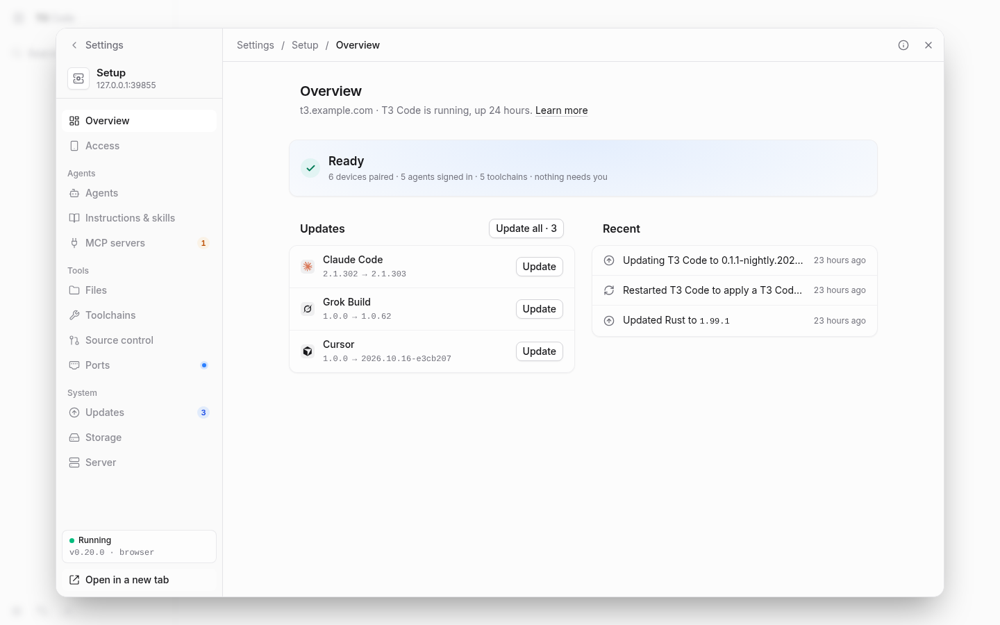
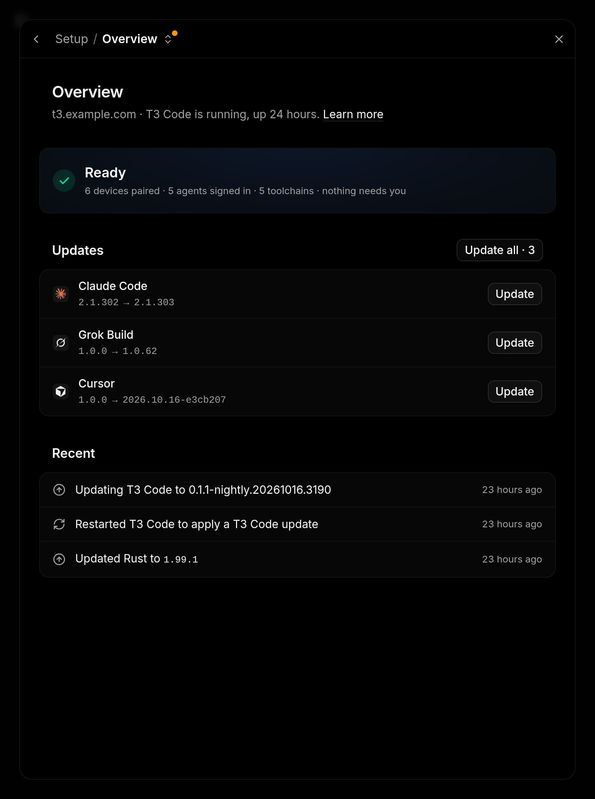
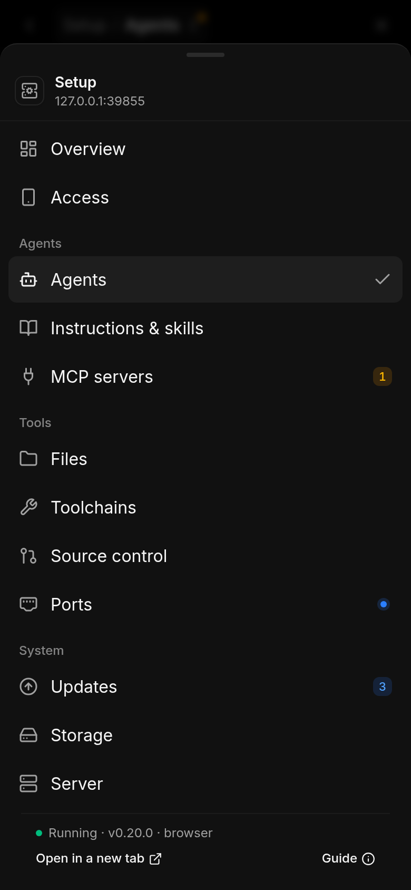

# The setup page

The container runs a setup page on port **3774**, next to T3 Code on 3773. It
does what T3 Code can't do before you're connected to it, pairing your first
device, and it also signs agents in, installs and updates agents and tools, and
publishes ports. None of this needs a shell in the container or a restart.

It's guarded by a setup key. Leave `T3_SETUP_KEY` empty and the first start
generates one and keeps it on the volume (`/home/t3/.t3/setup-key`), so it stays
the same across restarts, redeploys and recreates. Every start prints it to the
log, on the line after the one that names `T3_SETUP_KEY`:

```bash
docker compose logs t3code | grep -A1 T3_SETUP_KEY
```

Or choose your own when you create the container:

```
T3_SETUP_KEY=<something long>
```

Open port 3774 and enter the key. **Server → This console** shows the key
to a signed-in browser, and **Make a new key** in its **⋯** menu replaces a
generated one. That signs
out every browser that used the old key, and keeps the one you're using
signed in. A key set with `T3_SETUP_KEY` can only be changed there.

**Overview** lists what's left before a phone can use the server: the server
running, a [public URL](remote-access.md#the-public-url) set, a device paired, and the agents signed in, with a
button for the next step. When all four are done, the list collapses to a
single **Ready** line and the page becomes a health check: **Needs you** lists
anything failed or signed out, and problems with the container itself (a home
or state folder that a recreate would lose, a disk over 80% full, settings an
older image left behind), each with the one thing to do; **Updates** shows what
can update, with **Update all**; and **Recent** what happened lately. On a desktop the
pages are in a sidebar: Overview and Access, then **Agents** (Agents,
Instructions & skills), **Tools** ([Files](files.md), Toolchains, Source control, Ports) and
**System** (Updates, Storage, Server). On a phone the most used are in a tab
bar and the rest under **More**, and everything fits a 390 px screen. Each page
opens with one line on what it's for and a **Learn more** link to its guide.
Addresses from before the pages moved, such as `#devices`, still work.

On **Access**, **Create pairing link** gives you a URL and a QR code for your
public address, valid for as long as you choose, plus the **pair code** on its
own for clients such as the desktop app that ask for a server URL and a code
separately. When the device pairs, the page says **Paired with …** and offers
**Open T3 Code**; it also tells you if the link expires or is revoked first.
Paired devices and unused links are listed below, with **Revoke** in each
one's **⋯** menu. Choose **Rename** in a paired device's menu to change its
label without pairing again. Labels are saved on the state volume and survive restarts; leave the
label blank to restore the device's original name.
The rename form is a compact dialog on desktop and a bottom sheet on a phone.
Enter saves changes; Escape cancels.

Each row shows the one action its state needs (**Install**, **Sign in**,
**Update** or **Retry**) and keeps the rest in its **⋯** menu, which is a
bottom sheet on a phone. Uninstalling, revoking and publishing a database port
ask for confirmation. **⌘K** (Ctrl K) opens a palette with every action and
page, `G` followed by a letter goes to a page (hover a page in the sidebar to
see its letter), and `P` on Access creates a link.

The sidebar's server card shows which image is running, such as
`v0.7.0 · browser`, next to the server's health. It comes from a stamp written
at build time: the release tag in CI, or `dev` for a local build.
**Server** shows where state and work are stored and whether those volumes
survive a recreate (with the commands that move one that would not), the agent
browser, **Copy diagnostics** (the status with identifying details removed,
for bug reports) and **Lock**, which signs this browser out if it came in with
the key. **Restart** there restarts T3 Code inside the container, which keeps
running. Open apps reconnect by themselves, and any agent turn in progress
stops. T3 Code exiting on its own still ends the container, so a crash is left
to the container's restart policy rather than hidden.

The page is a single self-contained document. It loads no fonts, scripts or
styles from anywhere else, which helps over a slow tunnel.

`T3_SETUP_ENABLED=0` turns the setup page off.

## Opening it from T3 Code

If the setup page is reachable at `/__setup` on the same hostname as T3 Code
(see [Exposing it through one hostname](remote-access.md#exposing-it-through-one-hostname)),
T3 Code links to it in these places:

- Before a browser is paired, T3 Code's pairing screen has a small **Setup**
  button in the bottom-left corner. It opens the setup page in a new tab, which
  asks for the key.
- Once paired, **Setup** is pinned at the foot of **Settings** navigation. It
  opens inside the same Settings surface, in T3 Code's theme, without asking
  for the key. The count names things that need you; available updates are not
  included. The pin stays visible while the native settings list scrolls.
- On a wide window, Setup's grouped pages replace the Settings navigation.
  **Settings** in the breadcrumb or **‹ Settings** returns to the native page
  you were on. On a narrow window, Setup fills the Settings surface and
  **Setup / Overview** opens its page menu. The menu is a popover when there
  is room and a bottom sheet on a phone.
- **Esc** or **✕** closes Settings, just as on T3 Code's own pages. An open
  Setup dialog takes Escape first. **Open in a new tab** in Setup's navigation
  or page menu opens the standalone console. Control-click or Command-click
  on a navigation row opens that standalone page too.
- In T3 Code's command palette (**⌘K**), searching for **setup** offers **Open
  setup**. Searches such as **setup files**, **pair**, **agents** or **ports**
  open Settings on that Setup page. A short search such as "set", which could
  equally mean T3 Code's settings, keeps Enter with T3 Code's first result.

Resizing keeps the same frame and any unsaved draft. Reloading while Setup is
open restores its page for this browser tab; leaving Setup clears that
remembered page. The standalone console keeps its own sidebar and phone tabs.

<picture>
  <source media="(prefers-color-scheme: dark)" srcset="media/setup-tab/desktop-dark.png">
  
</picture>

<details>
<summary>Narrow windows and phones</summary>

| Narrow Settings surface | Phone page menu |
| --- | --- |
|  |  |

The screenshots use synthetic fixture data. Settings chrome comes from the
pinned native T3 Code client.

</details>

Setup uses T3 Code's own
session. It asks T3 Code about the browser's session cookie and lets the
browser in only if T3 Code says the session is valid and includes terminal
access. A browser with a terminal in the container can already read the key
from the environment, so this gives it nothing new. A device revoked in T3 Code
loses access here within half a minute, or immediately if you revoke it on the
setup page. Requests that change something are only accepted from the setup
page's own origin. Set `T3_SETUP_ACCEPT_T3_SESSIONS=0` to ask for the key every
time.

Neither link appears unless the setup page is routed on T3 Code's hostname, and
neither changes anything else in T3 Code's pages.

## Global agent instructions

**Setup → Context** edits one shared global `AGENTS.md`, with Markdown upload
and download. Claude Code, Codex and OpenCode can each use **Shared** global
instructions, a **Separate** file, or **None**. Switching to Shared backs up an existing
file; switching back restores it, or creates an independent copy of the shared
instructions. Separate files can be edited in place, preserving symlinks and
permissions. Start a new agent session to load changes.
The **Skills** tab joins physical skills across installed agents in one library,
with search, combined filters, folder reach and per-agent controls. Its inspector
shows locations, safe file metadata and Markdown, with revision-protected editing.
A three-step source installer reviews immutable files, chooses destination folders
with a fewest-copies planner, confirms replacements and reports partial results. All seven agents' own user folders
support adding, editing and removing local skills. Managed Codex reports native
enabled/disabled state and supports verified enable/disable controls for user
skills. Claude exposes its four native visibility states; OpenCode exposes
allow/ask/deny user policies and reports the Build agent's effective rule.
Unmanaged shared skills can be added, edited and removed from Codex/OpenCode.
Other providers show **Found** with a discovery-only explanation. Phone layouts
use grouped lists and bottom sheets. Status polling does not rescan skills or reset drafts.
The separate **[MCP servers](mcp-servers.md)** page defines servers once and
compares every installed agent’s native copy. Add/Remove, per-agent On/Off,
difference review, snippet import, editing, sharing and removal all check native
revisions and preserve backups. Its inspector masks credentials until revealed.
Grok Build is imports only; Muse Code and Antigravity are not managed here.
See [Context management](context-management.md) for paths and verification.
