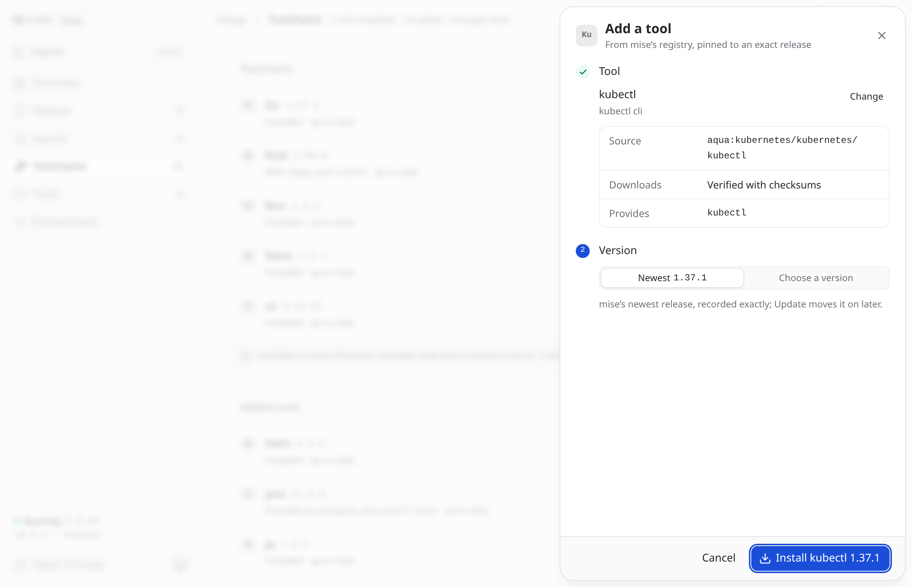

# Toolchains

Go, Rust (with clippy and rustfmt), Bun, Deno and uv install on first start,
alongside the agents, through [mise](https://mise.jdx.dev/) into the persistent
home, and work in every directory. The **Toolchains** page updates or removes
each one, installs any you left out of `T3_PREINSTALL`, and adds other tools
(see below). Node and Python are part of the image.

Managed Rust follows the stable channel, resolved to an exact numbered release
before checking or installing an update. Rolling names such as `stable` and
`beta` are not separate upgrade versions. Updates retain clippy and rustfmt,
respect the release-age policy, and keep a newer installed release selected.
Checking for updates does not change the installed toolchain.

## Any other tool

**Add a tool** on the Toolchains page searches mise's built-in registry of
about a thousand tools, from `kubectl` and `terraform` to `java` and `zig`. You
can search by name, by a command the tool provides (`rg` finds ripgrep), or by
what it does (`json`). A backend spec works too: `npm:prettier`,
`cargo:ripgrep`, `github:owner/repo`. Before anything is installed, the sheet
shows where the tool comes from, how its downloads are verified, which commands
it provides, and whether any of them is already in the image (an added `node`
takes precedence in terminals and for agents). Choose the newest release or any
other; a prefix like `3.12` picks the newest release under it.

<p align="center">
  
</p>

Added tools follow the same rules as the toolchains: they're installed into the
global mise config at an exact version, one operation at a time, and never
updated on their own. Each row shows when a newer release is available, and
**Update all** includes them. Tools you add with `mise use -g` in a terminal
appear in the same list and can be updated or removed there. ⌘K searches the
registry too: type `install terraform`. From a shell:

```bash
docker compose exec t3code t3-harness packages                       # what has been added
docker compose exec t3code t3-harness install kubectl                 # newest, recorded exactly
docker compose exec t3code t3-harness install python --version 3.12   # newest 3.12.x
docker compose exec t3code t3-harness update kubectl
docker compose exec t3code t3-harness uninstall kubectl
```

The agents and the five toolchains are managed on their own pages under any of
their names (`claude-code`, `core:go`), so nothing is configured twice.

Projects can still use their own versions. mise reads whatever a project
already declares (`mise.toml`, `.tool-versions`, or files like `.nvmrc`,
`go.mod` and `rust-toolchain.toml`), so two projects can use two different Node
versions, and an agent that runs `node` in a project directory gets that
project's version:

```bash
docker compose exec -u t3 -w /workspace/myapp t3code mise install       # what mise.toml asks for
docker compose exec -u t3 -w /workspace/myapp t3code mise use node@22   # pins it exactly
```

Three policies are set in `/etc/mise/config.toml`:

- **Nothing updates on its own.** `mise use` records the exact version it
  resolved, not a floating range.
- **No silent fallback.** If mise can't provide a declared tool, it fails
  instead of running a different one from `PATH`.
- **New releases wait a day.** A release counts as the newest once it has been
  out for 24 hours (`minimum_release_age`). Naming an exact version installs it
  right away.

Toolchains are installed in `/home/t3/.local/share/mise` (Rust in `~/.rustup`
and `~/.cargo`) and survive a recreate with the rest of the volume. The default
set is a little over 1 GB, which lives on the volume instead of in every image
pull.
