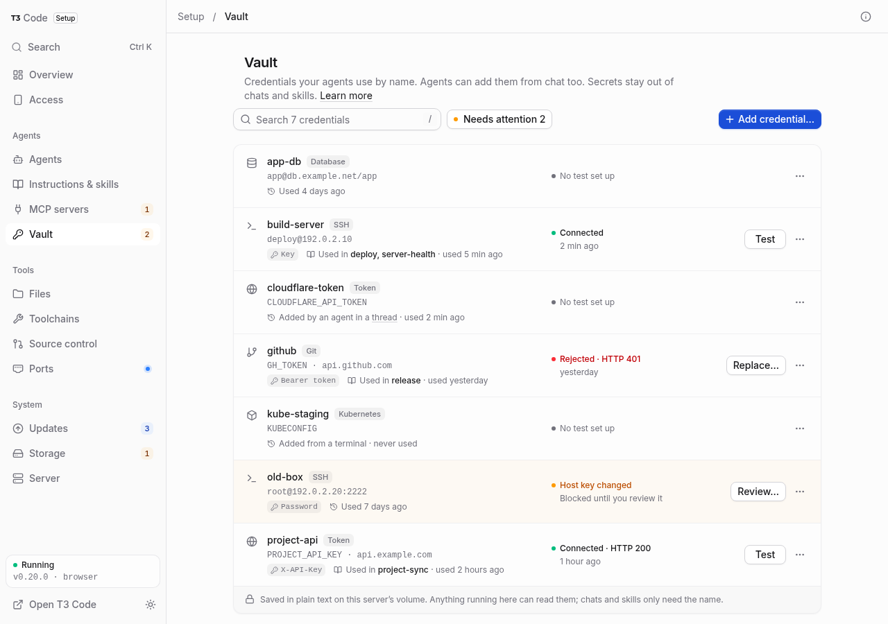
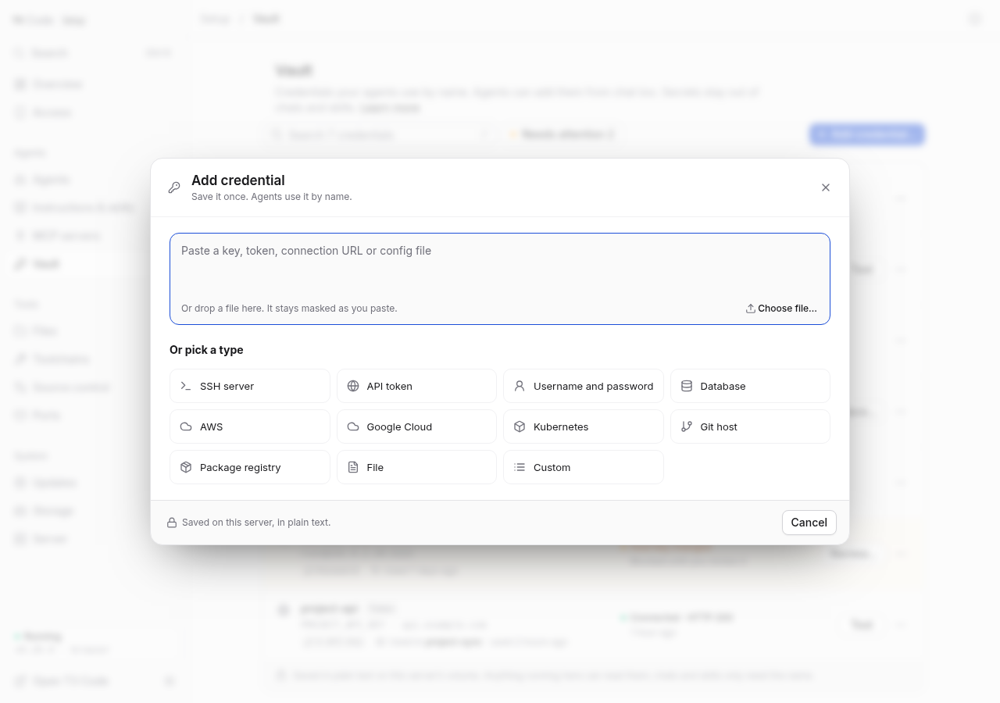

# Vault

The Vault saves passwords, keys, tokens and other credentials on this server, so
every agent can use them by name without the secrets going into chats or skill
files. You can add them in **Setup → Vault**, or an agent can ask you for one in
chat and save it there.



## In a chat

Agents check the Vault before asking you for a secret. If what they need isn't
there, they ask with T3 Code's secret card and save what you enter. The value
stays out of the chat, and no agent has to ask for it again, in any thread:

```text
You:    Deploy this to Cloudflare
Agent:  t3-vault list                 (nothing for Cloudflare)
        request_secret                card: "I'll save it in your Vault as cloudflare-token"
You:    paste the token
Agent:  t3-vault add cloudflare-token --env CLOUDFLARE_API_TOKEN --secret-file <file>
        t3-vault run cloudflare-token -- wrangler deploy
```

If a token gets rejected later, the agent asks again and replaces it, so you can
fix it from the chat. If you only want a secret used once, say so and the agent
won't save it.

The card has a single-line box. Tokens, passwords, SSH keys and JSON key files
fit. Kubeconfigs and `.env` files don't, so agents ask you to paste those in
**Setup → Vault**.

Agents learn about the Vault from a skill called `t3-vault`, installed for every
agent when Setup starts. It behaves like any other skill: your edits stay, a
removed copy stays removed, and only an untouched copy gets updated by a new
image.

## In Setup

Choose **Add credential…**, then paste a key, token, connection URL or config
file, or drop a file. Setup works out what it is and fills in the form. You can
also pick a type yourself:

| Type | Saved | What a command gets |
| --- | --- | --- |
| SSH server | Host, user, and a key or password | Plain `ssh NAME`, `scp` and `git` with a key, and `t3-vault ssh NAME` with either |
| API token | Token, and optionally an API address | A variable you name, and `t3-vault http` with an address |
| Username and password | Both, and an address if you like | `NAME_USERNAME`, `NAME_PASSWORD` |
| Database | Host, user, password, database | `DATABASE_URL`, and `PG*` or `MYSQL_*` variables |
| AWS | Access key ID, secret key, session token, region | The standard `AWS_*` variables |
| Google Cloud | Service account key file | `GOOGLE_APPLICATION_CREDENTIALS`, a temporary file |
| Kubernetes | Kubeconfig | `KUBECONFIG`, a temporary file |
| Git host | Token, host | `GIT_TOKEN` or a name you choose, and `git` over HTTPS to that host |
| Package registry | Token, username | Variables you name |
| File | Any text file | A variable holding the path of a temporary file |
| Custom | Any variables | Each one under its own name |

Names use up to 64 lowercase letters, numbers and single hyphens. The name and
type can't change after creation, because skills depend on them.

**Test** works before saving where a test is possible, which means SSH servers
and anything with an API address. A draft test doesn't save anything. For an API,
choose a relative test path such as `account` that needs authentication: a public
endpoint answers even with a bad key. Tests only run when someone asks for them,
and report the HTTP status without showing the response.



## SSH servers

Choose how agents sign in:

- **Generate a key.** Made on this server, so there's nothing to paste. You add
  one line to the remote server, shown in the form.
- **Use my password once.** Signs in with your password to add a new key, checks
  that the key works, and doesn't save the password.
- **Use an existing key.** Paste or upload it. A passphrase is used once to open
  the key and isn't kept, because agents couldn't answer a prompt for it.
- **Keep using a password.** For servers that don't allow keys.

A saved password can also move to a key later, with **Switch to a key…**.

Saved servers work with the normal tools. The Vault keeps one generated file and
adds a single `Include` line at the top of `~/.ssh/config`, so `ssh prod uptime`,
`scp app.tar prod:/srv/` and `git clone prod:repo.git` just work. Everything else
in that file stays as you left it. If the line can't be added, for example because
that file is a link, use `t3-vault ssh prod -- uptime` instead.

Plain `ssh` can't answer a password prompt, so a server that signs in with a password
uses `t3-vault ssh prod -- uptime`, and `t3-vault run prod -- scp app.tar prod:/srv/`
for other tools.

### Trusting a server

Each credential pins one server key, and a different key later blocks it:

- **Key sign-in** pins the key the first time the server is reached. An impostor
  can't get your private key this way, but commands would still run on it, so
  check the fingerprint if that matters to you.
- **Password sign-in** waits for you to confirm the fingerprint, because sending a
  password to an impostor would give it away. Compare it with the server's own,
  using the command shown, then choose **Trust this host key**.

If a key changes, **Review…** shows both fingerprints, and **Keep blocking** is the
safe default. A reinstall may explain a new key, but check through a trusted
channel before choosing **Trust new key**. Changing a credential's host or port
forgets its pin, and neither trust nor testing changes your `~/.ssh/known_hosts`.

Saving stores the secret, trusting confirms the server's identity, and testing
proves the sign-in works. A scanned key arrives over an unverified connection,
so confirm its fingerprint out of band with the command shown (or your
provider's console). Never bypass trust with `StrictHostKeyChecking=no`,
edited `known_hosts` files, or relaxed sshd throttling to make scans pass.

## From a terminal or a skill

```sh
t3-vault list                             # What's saved, and how to use each one
t3-vault show NAME                        # Details of one credential
t3-vault run NAME... -- COMMAND [ARG...]  # Run a command with those secrets in its environment
t3-vault ssh NAME [-- COMMAND [ARG...]]   # Run a command on a saved SSH server
t3-vault http NAME METHOD PATH [--stdin]  # Call a saved API
t3-vault add NAME [--type TYPE] [OPTIONS] # Save a credential (see t3-vault types)
t3-vault replace NAME --secret-file FILE  # Replace its secret
t3-vault test NAME                        # Check that it still works
t3-vault trust NAME [FINGERPRINT]         # Review or confirm a server's identity
t3-vault use-key NAME                     # Move a password sign-in to a new key
t3-vault rm NAME --yes                    # Delete it
```

`run` hands the secrets to that one command. `NAME=VAR` gives the main secret a
different variable name, for tools that expect one. Files such as kubeconfigs
become temporary files that are removed when the command ends.

`t3-vault http` accepts GET, HEAD, POST, PUT, PATCH and DELETE, with paths relative
to the saved address. `--stdin` sends a JSON body of up to 1 MiB. Requests stay
under the address, verify HTTPS certificates and never follow redirects.

No command prints a saved secret, because whatever an agent prints ends up in its
transcript. Secrets can't go on the command line either, for the same reason.
They come from a file, stdin or a hidden prompt at a terminal.

To use a credential from a skill, open it and choose **Copy snippet**, or adapt the
[example skills](../examples/skills). If an old login appeared in a chat or a
skill's history, rotate it: removing the text doesn't remove earlier copies.

## What's protected, and what isn't

Secrets are saved in **plain text** on the state volume, in an owner-only folder.
Agents run as the same user, so **any agent can read them** if it sets out to. The
Vault keeps secrets out of chats, skill files and command lines. It doesn't lock
them away from a misbehaving agent, or from text that tricks one.

Output from `run`, `ssh` and `http` hides saved values in their literal,
JSON-escaped, URL-encoded and Base64 forms, and long lines of a key or file. That
catches accidents, such as a tool repeating its own token. It can't stop a command
that sets out to reveal one, such as `t3-vault run x -- sh -c 'echo "$TOKEN" | rev'`.

Protect the volume and its backups. Deleting a credential erases it from this
server, but older backups still hold it, and it keeps working at the service until
you revoke it there.

## Understand a saved credential

The list shows each credential's type, target, last test, who added it and when it
was last used. Plain `ssh NAME` counts as a use. `scp` and `sftp` turn off the
OpenSSH feature this relies on, so they don't. Failed tests and untrusted servers
appear in **Needs attention**, Overview and Setup's count in T3 Code. A single
timeout doesn't count; two in a row do.

**Used in** scans global skills for all seven providers and shared `AGENTS.md`. It
looks for `t3-vault` commands and `ssh NAME`, and doesn't follow shell variables,
run files or scan project-local skills. If a folder is unreadable or a scan limit
is reached, the page says usage is incomplete rather than claiming something is
unused.

## Edit or delete

Saved secrets are write-only. **Replace…** takes a new value, and **Keep saved** or
an empty replacement keeps the current one. Show/hide only reveals a value you just
typed. Closing the editor clears it. Unsaved changes ask before they're discarded.

If another window or an agent changes the same credential while you're editing, the
editor shows what changed. **Use theirs** adopts the current details, **Keep mine**
retries your draft, and a credential deleted elsewhere can be **Saved as new**.

## Storage and recovery

Everything lives in `$T3CODE_HOME/server-credentials/`, normally
`/home/t3/.t3/server-credentials/`. The folder is owner-only (0700), and so are its
files (0600).

| File | Purpose |
| --- | --- |
| `credentials.json` | Saved credentials, including their secrets in plain text |
| `state.json` | Disposable test results and host key details, without secrets |
| `known_hosts/<name>` | The one pinned key for that SSH credential |
| `keys/<name>`, `ssh_config` | Generated for OpenSSH from `credentials.json` |
| `usage/<name>.json` | Disposable record of when it was last used |
| `skill.json` | Which version of the `t3-vault` skill was last installed |

Older stores are upgraded automatically when Setup starts, and a failed upgrade
leaves the original untouched. `state.json`, `usage/` and the generated files can be
lost without losing a credential. An unreadable `credentials.json` shows an error
and stops writes rather than being treated as empty: restore it privately from a
backup, with its ownership and permissions. Don't paste it into an issue or a chat.

The page's API uses Setup's authentication and same-origin protections, and saved
secrets never appear in its responses, in `/status` or in browser storage. Serve
Setup over HTTPS or a trusted private connection.
